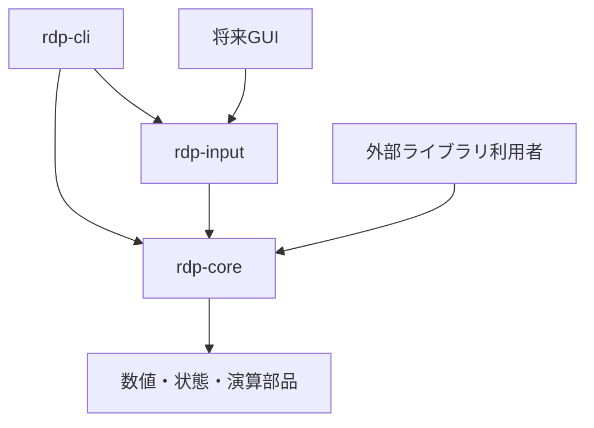

# 00 プロジェクト基盤・公開境界

版：D-1.0 / 2026-11-14（日本時間）。実装用仕様、製品コードは未実装。

## 1. 目的・適用範囲

3クレートの配置、依存方向、公開境界、共通実装規約を定める。基準は[全体設計](../rdp-calc-detailed-design.md)第2章・第12章と[IA](../rdp-calc-input-api-design.md)§1・3。入力APIはIAを優先する。個別の演算・入力契約は01～12、全体受入は13に置く。

本シリーズは既存契約の具体化であり、HP完全互換を宣言するものではない。暫定契約は暫定として実装・試験し、未定義の境界は該当機能の実装ゲートに残す。

## 2. 配置と依存

```text
Cargo.toml                       workspace
crates/rdp-core/src/              計算ライブラリ
crates/rdp-core/tests/            Core公開API試験
crates/rdp-input/src/             キー編集・セッションライブラリ
crates/rdp-input/tests/           入力公開API・協調原子性試験
crates/rdp-cli/src/               CLIバイナリ
crates/rdp-cli/tests/             CLIプロセス・入出力試験
tests/scenarios/                  共有シナリオデータ
documents/details/               本シリーズ
```

上記は作成時の目標配置。現行の単一crate雛形とCargoを本作業では変更しない。crate名は`rdp-core`、`rdp-input`、`rdp-cli`、CLI実行名は`rdp-calc`とする。editionは実装開始時に現行2024を基点として対応ツールチェーンを確認し、選択を実装記録へ残す。最低Rust版や依存パッケージの版は本書で推測しない。



矢印は呼出し・依存方向。CoreからCLI、入力アダプター、端末、GUIへ依存させない。CLIに計算式の再実装を置かず、GUIにキー編集を複製しない。

## 3. モジュールと公開境界

| 所有元 | 主な型・モジュール | 公開方針 |
|---|---|---|
| Core config/word/number | Radix、NumericMode、SignedMode、WordConfig、WordSize、Word、Number | 公開値型。内部フィールドは各仕様に従う |
| Core flags/error | Flags、CalcError | 公開。Flagsの実状態変更はCore内に限る |
| Core bitwise | RotateKind、BitEdit | 定義所有元はbitwise、libから公開再公開 |
| Core command/calculator | Command、ValueUpdate、Calculator、StackLift | 公開操作窓口。CommandMetadataは内部 |
| Core state/stack/register | CalculatorConfig、CalculatorSnapshot / CalculatorState、RpnStack、RegisterBank | 前2型は公開、後3型はcrate内部 |
| Core arithmetic/format | 内部評価関数 / format_number | 評価部品は内部、表示関数は公開 |
| Input | Key、InputEvent、HpInputSession、InputSnapshot、EntryPhase、EntryPart、InputError、SessionError | 公開。InputState、edit、finish、apply_candidateは内部 |
| CLI | options/parser/literal/session/repl/batch/output/error | CLI crate内部。mainは接続と終了コード決定 |

Core内部はconfigを下位とし、error→config、word/number→config/error、state→数値/stack/register/flags、calculator→state/command/評価部品とする。command→bitwiseのenum参照は許可し、逆参照は禁止。flags更新指示は01が所有し、評価部品はそれを返す。

Calculatorは実計算状態の変更窓口。HpInputSessionはCalculatorを所有し、mutable getter、restore、公開Lift setterを設けない。Snapshotは独立した値コピーであり、変更しても元へ反映しない。

## 4. 共通実装契約

- 公開操作は入力を検証し、利用者入力によるpanic、未検査index、幅以上のシフトを起こさない。
- 純粋評価は引数・グローバル状態を変更しない。状態変更操作は候補全体へ適用して成功時だけ置換する。
- 原子性の範囲はCore、Core＋編集、Core＋編集＋pendingで異なる。逐次バッチの先行成功は保持する。
- 内部state不変条件は外部引数エラーより先に検査する。エラー順位は01とIA§4に従い、安全な前提がない演算を行わない。
- 回復可能な確保失敗はAllocationFailed。OSによるOOM abortやプロセス強制終了からの回復は保証しない。
- 設計中のRust宣言はインターフェース仕様であり、関数本体省略を含む。製品のコンパイル成功や試験実行を意味しない。

## 5. 受入・試験

Workspace化時は3クレートのビルド・試験が実行でき、Coreが入力やCLIを参照しないことを確認する。共有シナリオは各crateのテストから読み込み、workspace直下のデータ配置だけで試験が自動実行されるとは扱わない。

試験は[13](13-integration-and-compatibility.md)に従う。private不変条件・fault injectionは所有モジュール内に置き、検証専用の公開APIは追加しない。各段階の未実装依存は持越しとして記録する。

## 6. 残件と境界

GUI固有画面、HP表示窓、HPエラー解除キーは本単位の対象外（TBD-012/018）。内蔵プログラミングはTBD-015で対象外確定。Iレジスタ・間接・倍長・LJ等はTBD-014/019/020の判断後に別仕様へ追加する。edition・依存ライブラリ選定は実装基盤の記録事項で、既存の算術契約変更ではない。
