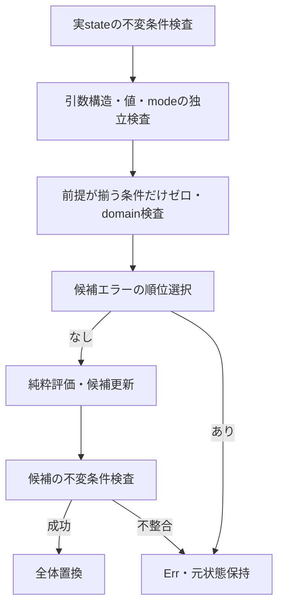

# 01 設定・エラー・フラグの基礎

版：D-1.0 / 2026-11-14（日本時間）。実装単位の製品仕様。

## 1. 対象・根拠・依存

Coreのconfig/error/flagsを扱う。[全体設計](../rdp-calc-detailed-design.md)§3.2～3.5・4.3・4.10・4.13、[IA](../rdp-calc-input-api-design.md)§4が根拠。入力・CLIのエラー型は各所有crateで定義するが、分類と順位を本書に集約する。前提は[00](00-workspace-and-boundaries.md)、幅と数値の検証は[02](02-word-and-number.md)。

## 2. 設定型・初期値

| 型 | 値・契約 |
|---|---|
| Radix | Binary/Octal/Decimal/Hexadecimal、base()は2/8/10/16 |
| NumericMode | Integer/FloatingPoint |
| SignedMode | Unsigned/OnesComplement/TwosComplement |
| WordConfig | public size: WordSize、signed_mode: SignedMode、ones_zero_mode: OnesZeroMode（Canonical / Raw、初期値Canonical） |
| CalculatorConfig | public word_config、radix、numeric_mode、register_count |
| StackLift | Enabled/Disabled、計算状態としてCoreが所有 |

CalculatorConfig::defaultはW16/TwosComplement/Hexadecimal/Integer、16レジスタ。validateは個数1～1024、FloatならDecimalであることを確認する。個数不正はInvalidRegisterCount、設定組合せ不正はInvalidConfiguration。無効WordSizeは生成入口で拒否する。resetの初期設定はdefault固定ではなく、そのCalculatorの生成時設定。

CLIの`--float`で基数未指定ならDecimalを選ぶ。明示的な非DEC指定との競合はCLI構文エラーであり、Coreの生成設定エラーと区別する。

## 3. エラー型と順位

```rust
pub enum CalcError {
    InvariantViolation, AllocationFailed,
    DivisionByZero, DomainError,
    IntegerOutOfRange, FloatingPointOutOfRange,
    InvalidWordSize(u8), InvalidRegisterCount(usize), InvalidRegister(usize),
    InvalidFlag(u8), InvalidBitIndex(u8), InvalidCount, InvalidConfiguration,
    NumericModeMismatch, UnsupportedOperation,
}
```

| 順位 | 同順位内の順番 |
|---|---|
| 0 | InvariantViolation |
| 1 | AllocationFailed |
| 2 | DivisionByZero、DomainError |
| 3 | IntegerOutOfRange、FloatingPointOutOfRange |
| 4 | InvalidWordSize、InvalidRegisterCount、InvalidRegister、InvalidFlag、InvalidBitIndex、InvalidCount、InvalidConfiguration |
| 5 | NumericModeMismatch、UnsupportedOperation |

同variantの複数対象はX→Y→Z→T→LAST X→R0以降。順位は独立に安全に検査できる原因同士へ適用し、型や引数の前提がない計算を試して上位エラーを作り出さない。



実state不整合は即InvariantViolation。候補の不整合もInvariantViolationで実stateを保持する。例：IntegerでPush(Float(NaN))はFloatingPointOutOfRange、FloatでEditBit(index=255)はInvalidBitIndex、FloatのAndはNumericModeMismatchとして演算しない。通常整数overflowはErrではなく成功＋flags。

CalcError、InputError、SessionError、LiteralError等の意味エラーはDebug/Clone/PartialEq/Eq、Display、std::error::Errorを実装する。Io(std::io::Error)を含むCliRuntimeErrorにClone/Eqを要求しない。CalcErrorのDisplayは短い英文、sourceはNone。合否は文面でなくvariant/payloadで比較し、エラー型自体は出力・終了・状態変更しない。

### 入力・CLIの分類

InputErrorはInvalidDigit { digit, radix }、InvalidNumber、IncompleteEntry、InputInProgress、InputTooLong、InvariantViolationの6variant。既存資料の「入力固有5種」は通常入力エラー5種を指し、IA§3の内部不整合variantも保持する。SessionErrorはInput(InputError)/Calculation(CalcError)。LiteralErrorはInputTooLong、InvalidDigit { digit, radix }、InvalidNumber、FloatingPointOutOfRange。

セッションは内部不整合→回復可能確保→独立に判定可能なCore条件→InputTooLong→InputInProgress→InvalidDigit/InvalidNumber/IncompleteEntry。Coreの内部不整合はCalculation側、編集状態の不整合はInput側へ包む。同順位の内部検査はCore→InputStateの順に具体化し、両方が破損した人工fixtureではCalculation(InvariantViolation)を返す。Coreが正常で編集不整合だけならInput(InvariantViolation)。いずれも破損を含む元状態を変更しない。

CLI解析は長さ→符号/接頭辞/桁存在→左端の不正桁→有限Float変換。解析失敗ならCoreを呼ばない。CLIランタイムはSyntax/Literal/Input/Calculation/Ioへ分類し、終了コードはそれぞれ2/2/1/1/3。

## 4. フラグ型とAPI

Flagsはprivate bits: u8、初期0。上位2bitは常に0。F0～2は利用者用、F3は先頭ゼロ表示、F4=Carry、F5=Out-of-range。状態変更はCore内部だけで行う。

```rust
pub(crate) enum FlagAction { Keep, Clear, Set }
pub(crate) struct FlagUpdate {
    pub(crate) carry: FlagAction,
    pub(crate) out_of_range: FlagAction,
}
impl Flags {
    pub fn get(&self, index: u8) -> Result<bool, CalcError>;
    pub fn carry(&self) -> bool;
    pub fn out_of_range(&self) -> bool;
    pub(crate) fn set(&mut self, index: u8, value: bool) -> Result<(), CalcError>;
    pub(crate) fn apply(&mut self, update: FlagUpdate);
}
```

get/setは0～5のみ。範囲外はInvalidFlagで不変。applyはF4/F5だけを変更し、F0～3を保持する。FlagUpdate::keepは両方Keep、from_conditions(None/Some(false)/Some(true))はKeep/Clear/Set。Cond(p)は評価時にClearかSetへ解決し、前値を参照しない。命令別条件は04/05に置く。

## 5. 受入・TBD

TEST-055、IA-C006/008/009/014～016で番号境界、KeepとClearの区別、全順位・同列順・対象順、安全な依存ガードを検証する。F4/F5の前値0/1を独立に変え、F0～3を保持する。内部順位関数の試験だけで実命令経路の試験を代替しない。

TBD-007の更新条件は04・05の命令表に従う。TBD-012ではCLIの診断と将来GUIの通知ダイアログが同じエラーを扱う。GUIは次の電卓入力を通常処理する。
