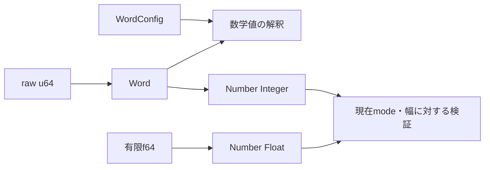

# 02 数値表現

版：D-1.0 / 2026-11-14（日本時間）。実装用仕様、製品コードは未実装。

## 1. 対象・根拠

Coreのword/number、値域、基本変換と検証を規定する。[全体設計](../rdp-calc-detailed-design.md)§3.3・4.7・7.1、[IA](../rdp-calc-input-api-design.md)§2～4が根拠。依存は[01](01-config-errors-and-flags.md)。全領域の設定切替は12、CLIの切り捨て解析は10、キーの厳密入力は08が担当する。

## 2. データ型・不変条件

WordSizeはprivate u8で1～64のみ生成可。Wordはprivate bits: u64で、幅を自身に保持しない。Numberはpublic enum Integer(Word)/Float(f64)。WordConfigは幅と符号形式を持ち、Wordのraw bitをどの形式として読むかを決める。

W=幅、M=2^W−1、S=2^(W−1)とする。

| 形式 | 数学値域 | rawからの解釈 |
|---|---|---|
| Unsigned | 0～M | rawそのもの |
| TwosComplement | −S～S−1 | MSB=1ならraw−2^W、他はraw |
| OnesComplement | −(S−1)～S−1 | MSB=1なら−((~raw)&M)、他はraw |

Onesの+0はraw0、−0はraw M。W1では±0だけが存在する。数学値への変換で負0を失っても、状態の正本rawを置き換えない。Floatの有限値と±0、subnormalを保持し、NaN/Infは状態へ取り込まない。



## 3. APIと契約

```rust
impl WordSize {
    pub fn new(bits: u8) -> Result<Self, CalcError>;
    pub fn bits(self) -> u8;
    pub fn mask(self) -> u64;
}
impl Word {
    pub fn from_bits(bits: u64, size: WordSize) -> Self;
    pub fn bits(self) -> u64;
    pub fn masked(self, size: WordSize) -> Self;
    pub fn is_negative(self, config: &WordConfig) -> bool;
    pub fn is_negative_zero(self, config: &WordConfig) -> bool;
    pub fn to_signed(self, config: &WordConfig) -> i128;
    pub(crate) fn from_integer(value: i128, config: &WordConfig) -> Result<Self, CalcError>;
}
impl Number {
    pub fn as_integer(&self) -> Option<Word>;
    pub fn as_float(&self) -> Option<f64>;
    pub(crate) fn validate(&self, mode: NumericMode, config: &WordConfig)
        -> Result<(), CalcError>;
}
```

- new(0/65～255)はInvalidWordSize(bits)。maskはW64でu64::MAX、それ以外で安全に計算する。
- from_bits/maskedは指定幅の下位bitだけを保持する明示的切り捨てAPI。bitsは格納rawをそのまま返す。
- is_negativeはUnsignedではfalse、符号付きではMSBを検査する。Onesの負0でもtrue。is_negative_zeroはOnesかつ幅内raw=Mだけでtrue。
- 解釈系メソッドは指定幅へマスクして計算する。ただし状態への取込みでは先に元rawの幅外bitを検査し、解釈のマスクで隠さない。
- to_signedはUnsigned最大値も収まるi128を返す。負0の数学値は0。
- from_integerは数学値域を厳密検査し、範囲外をIntegerOutOfRangeとする。0は正0。負0を作るにはfrom_bitsを使う。
- as_integer/as_floatはvariantが違えばNone。自動昇格・変換しない。

Number::validateは現在modeとの一致、整数rawの幅内、Floatの有限性を検査する。検出できる独立原因が複数なら01の順位。例：Integer modeのFloat(NaN)はFloatingPointOutOfRange、Float(1.0)はNumericModeMismatch。

Wordが元の幅を持たないため、幅16で作ったraw0x123をW8へPushすると拒否できるが、from_bits(0x123,W8)で既にraw0x23にした値の上位bit喪失を検出することはできない。公開APIの仕様上の限界として明示する。

## 4. 安全性・副作用

すべて無状態の値操作で、スタック・flags・LAST Xを変更しない。失敗ではResult::Errのみを返す。1u64<<64を使用せず、W64の2^Wは必要に応じu128で計算する。数値解釈で必要な符号拡張と、設定幅拡大のゼロ拡張を区別する。

## 5. 受入・残件

TEST-001～009でW1～64、各形式の最小・最大・±0を検証する。IA-C001/006/007で幅外値・非有限・mode違いを検査。raw0xFF/W8をUnsigned=255、Twos=−1、Ones=負0として解釈し、変換後もrawが変わらないことを確認する。

TBD-008の算術結果の正規化は演算側で行い、Wordは負0のrawを保持する。数値表現の受入だけで1補数演算・HP入力境界の互換合格とはしない。
