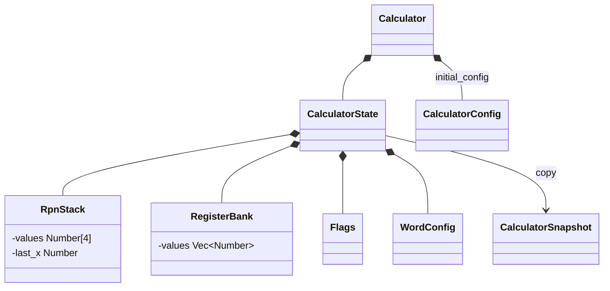

# 03 スタック・レジスタ・計算状態

版：D-1.0 / 2026-11-14（日本時間）。実装用仕様、製品コードは未実装。

## 1. 対象・根拠・依存

Coreのstack/register/stateの保存構造、低水準操作、初期化、Snapshotを規定する。[全体設計](../rdp-calc-detailed-design.md)§3.2・4.4・4.6・4.11・5.1、[IA](../rdp-calc-input-api-design.md)§3が根拠。01/02に依存し、命令効果は07、設定変換は12へ委譲する。

## 2. 所有と不変条件

CalculatorStateはstack、registers、flags、word_config、radix、numeric_mode、stack_liftを所有する。EntryPhase、buffer、EntryPartを持たない。全4段とLAST Xと全レジスタはmode一致、整数幅内、Float有限。Floatならradix=Decimal。flags上位2bitは0、レジスタ個数は生成時の固定長。

全4段に常に値があり、空・underflow・可変深度は存在しない。新規状態は全数値をmode対応の正0、flags=0、Lift=Disabledとする。生成設定は01に従う。

## 3. 低水準スタック操作

初期配列を[A,B,C,D]（X/Y/Z/T）、LAST XをLとする。

| 操作 | 結果配列 | LAST X |
|---|---|---|
| lift | [A,A,B,C] | L |
| drop_stack | [B,C,D,D] | L |
| swap_xy | [B,A,C,D] | L |
| roll_up | [D,A,B,C] | L |
| roll_down | [B,C,D,A] | L |
| set_x(V) | [V,B,C,D] | L |
| save_last_x | [A,B,C,D] | A |
| replace_all(values,last_x) | 指定4値 | 指定値 |

RpnStack::new(zero)は全5値をzeroにする。values()/x()/y()/z()/t()/last_x()はCopy値を返す。低水準操作はflags、Lift、入力状態を知らず、型整合は呼出側が検証済み。これらの操作自体にunderflowエラーはない。Command::Enter等の効果と混同しない。

## 4. RegisterBank

| 内部API | 契約 |
|---|---|
| new(count,zero) -> Result<Self,CalcError> | 1～1024を受理し、全要素zero。try_reserve失敗はAllocationFailed |
| get(index) -> Result<Number,CalcError> | 0以上len未満。範囲外InvalidRegister(index) |
| set(index,value) -> Result<(),CalcError> | index検証後に1要素置換。値は呼出側で検証済み |
| values() -> &[Number] | 不変スライス、公開外部へのmutable参照を出さない |
| replace_all(values) -> Result<(),CalcError> | 元と同じ長さのみ、全値検証は呼出側の責務 |
| clear(zero) | 個数を保ったまま全要素zero |

replace_allの長さ不一致は内部契約違反であり、InvariantViolationを返して元領域を保持する。これは既存の「同一長のみ受理」と不変条件エラーを内部APIへ具体化したもので、公開利用者向けの新variantを作らない。STO/RCLのLiftやLAST Xは07で決める。

## 5. 状態生成・検証・Snapshot

CalculatorState::new(&CalculatorConfig)は設定検証→領域確保→初期化。validate(&self)は全状態不変条件を検査し、破損はInvariantViolationとする。利用者が与えた値を検査するNumber::validateと役割を分ける。

CalculatorSnapshotのpublicフィールドはstack: [Number;4]、last_x: Number、registers: Vec<Number>、flags: Flags、word_config: WordConfig、radix: Radix、numeric_mode: NumericMode、stack_lift: StackLift。snapshotは全値の独立コピー。外部でコピーの内容を変えても実stateは不変。Flags自体のprivate性・setterの公開範囲を変更せず、flags破損の試験は内部fixtureで行う。

snapshotはResultを返さない既存APIを維持し、Vec複製時のOS OOMまで回復保証しない。状態変更を伴う回復可能確保の経路は01のAllocationFailed契約に従う。

Calculatorは生成時設定の独立コピーを保持する。レジスタ命令は直接指定のSTO/RCLのみ（TBD-019）。resetは現在の設定を捨てて生成時設定（OnesZeroModeを含む）へ戻し、4段/L/全レジスタを正0、flags=0、Lift=Disabled。セッション側は同時に編集を捨てる（09）。

## 6. 受入・TBD

TEST-010～014で配列式、TEST-031でindex15/16、TEST-061で生成個数0/1025拒否とresetを確認。IA-C012、IA-G010で所有層ごとのSnapshot独立性を検証する。失敗した公開更新は全領域不変。

TBD-011は固定16個の独自初期値として先行可。TBD-004の実機raw記憶領域再配置には現Vec<Number>で対応しない。現方式の幅変換は12の独自暫定契約とし、HPの記憶互換を主張しない。
