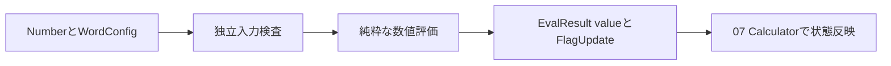

# 04 算術評価

版：D-1.0 / 2026-11-14（日本時間）。既存の確定・暫定契約を分けた実装用仕様。

## 1. 対象・依存・根拠

Core arithmeticの純粋評価を扱う。01のエラー・FlagUpdate、02の数値表現へ依存し、状態への反映は07が担当する。[全体設計](../rdp-calc-detailed-design.md)§4.8・7.1～7.4・7.7、[判断記録](../rdp-calc-design-decisions.md)DD-029/043が基準。CLIの負数解析は10の契約であり、CHS演算と混同しない。

## 2. 型・API

ArithmeticOpはAdd/Subtract/Multiply/Divide/Remainder、UnaryOpはChangeSign/Absolute/Sqrt。EvalResultはvalue: Number、flags: FlagUpdateを持つcrate内部型。

```rust
pub(crate) fn eval_binary(op: ArithmeticOp, lhs: Number, rhs: Number,
    config: &WordConfig) -> Result<EvalResult, CalcError>;
pub(crate) fn eval_unary(op: UnaryOp, value: Number,
    config: &WordConfig) -> Result<EvalResult, CalcError>;
```

lhs=Y、rhs=X。混在variantはNumericModeMismatch。幅外rawはIntegerOutOfRange、非有限FloatはFloatingPointOutOfRange。複数原因は01の安全な順位を適用する。関数はstack、LAST X、旧flags、Liftを読まず、変更しない。



## 3. 整数の共通規則

W=1～64、M=2^W−1、a=Y raw、b=X raw、y/xは形式に従う数学値。Unsigned乗算はu128を使い、最大(2^64−1)^2をi128へ変換しない。符号付き数学演算はi128、raw加算はu128。通常の数学的範囲外は成功し、幅内rawとG更新を返す。

| 演算 | 数値結果 | Carry | Out-of-range |
|---|---|---|---|
| ADD | Unsigned/Twosは(a+b)の低Wbit | raw和>M | 数学和が形式の値域外 |
| SUB | Unsigned/Twosは(a−b) mod 2^W | a<b（Borrow） | 数学差が値域外 |
| MUL | Unsigned/Twosは数学積の低Wbit | Keep | 数学積が値域外 |
| DIV | trunc(y/x)、結果を幅内へ | 余り≠0 | 数学商が値域外 |
| RMD | y−trunc(y/x)*x | Keep | Keep |
| CHS | 下記の形式別処理 | Keep | 数学的結果が値域外 |
| ABS | 絶対値を形式へ符号化 | Keep | 数学的結果が値域外 |
| SQRT | 最大整数k、k²≤x | k²≠x | Keep |

条件列はCond(p)：真ならSet、偽ならClear。KeepをClearで代用しない。F0～3は常に保持。各更新は純粋な指示であり、状態へは成功時だけ反映する。

DIV/RMDは数学値0の除数を拒否し、Onesの負0もDivisionByZero。商は0方向切捨て、非0余りの符号はY。Twos最小値/−1もi128で安全に計算し、DIVは元の最小値rawとG=Set、Carry=Clearを返す。RMDのC/Gは結果0でも保持する。

CHSはTwosでmod 2^Wの否定。Twos最小値は同じraw、G=Set。Unsignedは非0をmod 2^Wで否定しG=Set、0はraw0としG=Clearを暫定採用する。Unsigned CHS(0)のHP条件はTBD-007に残す。ABSはUnsignedなら値保持/G=Clear、Twos最小値ならraw保持/G=Set。

SQRTは浮動小数点へ変換せず整数平方根を求める。負の数学値はDomainError。積を使う場合はu128、または除算比較で安全に判定し、u64最大値で4294967295を得る。

## 4. 1補数の暫定演算

以下はTBD-008の暫定式であり、HP互換確定ではない。rawと符号bitを数学値とは別に保持する。

- ADDはraw和の低Wbitへ上位Carryを加え戻す。Carry判定は補正前raw和。Gは数学和の値域で判定。
- SUBはraw差の低Wbitを求め、a<bならさらに1を引いてWbitへ戻す。Gは数学差で判定。ADDとCHSの合成で代用しない。
- MULは絶対値積をMで剰余化し、符号bit XORが負ならWbit反転する。0結果の符号もXOR。W1でもM=1で処理可能。
- DIVの0商は符号bit XOR、RMDの0余りはYの符号bitを引き継ぐ。非0商は絶対値商を現在形式へ符号化する。合法な1補数の被除数と非0除数では商の絶対値は被除数以下で、商の範囲外は生じない。
- CHSはWbit反転。ABSは符号bitが1なら反転し負0を正0へ。SQRTは負0を数学0として扱い、正0を返す。

符号付き数学値だけの参照モデルでは負0結果を検証できない。小幅の全組合せ試験はrawとflagsも比較する。

## 5. Float評価

有限f64の四則、Remainder、CHS、ABS、SQRTを受理。RemainderはRust `%`相当の切捨て商の余りという独自拡張。±0除算はDivisionByZero、負sqrtはDomainError、非有限入力/結果はFloatingPointOutOfRange。subnormalとunderflowによる有限0を受理する。

通常演算はf64の丸めを許し、厳密変換の往復一致を要求しない。F4/F5ともKeep（TBD-007/016の独自暫定）。HPのFloat四則F5更新へ自動的に合わせない。CHSは符号反転で±0も反転し、ABSは負0を正0へ。LAST Xの保存例外は07で扱う。

## 6. 受入・実装ゲート

TEST-015～019/044～046/057～059/062/068/073。W1/2/4/8/16/32/63/64、全符号形式、0/±1/最小/最大/負0を対象とする。W1～4は独立参照式で全組合せを検査。Unsigned最大乗算raw1/G1、Twos最小値除算、RMD C/G保持、sqrt完全平方と非平方を確認する。

1補数暫定式の採用・保留を実装前に記録する。TBD-007/008/016が未解決でもUnsigned/Twosやf64基本演算は先行可能。製品試験の成功をHP実機照合の代用にしない。
