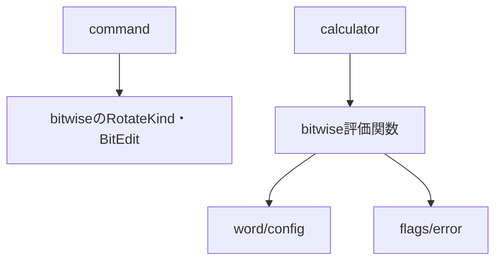

# 05 論理・ビット評価

版：D-1.0 / 2026-11-14（日本時間）。実装単位の製品仕様。

## 1. 対象・依存・根拠

Core bitwiseの純粋関数を扱う。[全体設計](../rpn-calc-detailed-design.md)§4.9・7.4～7.6が根拠。01のflags/error、02のwordへ依存する。回数Xの解釈、stack drop、LAST X、Liftの反映は07が担当する。

## 2. 型と公開境界

RotateKind { Left, Right, LeftCarry, RightCarry }、BitEdit { Set, Clear }の定義所有元はbitwiseで、Core libから公開再公開する。commandへ逆依存しない。LogicOp { And, Or, Xor, Not }、ShiftOp { Left, RightLogical, RightArithmetic }、BitwiseResult { value: Word, flags: FlagUpdate }はcrate内部型。



## 3. API

```rust
pub(crate) fn logic(op: LogicOp, lhs: Word, rhs: Option<Word>, size: WordSize)
    -> Result<BitwiseResult, CalcError>;
pub(crate) fn shift(op: ShiftOp, value: Word, config: &WordConfig)
    -> Result<BitwiseResult, CalcError>;
pub(crate) fn rotate(kind: RotateKind, value: Word, count: u8,
    size: WordSize, carry_in: bool) -> Result<BitwiseResult, CalcError>;
pub(crate) fn mask_left(count: u8, size: WordSize) -> Result<BitwiseResult, CalcError>;
pub(crate) fn mask_right(count: u8, size: WordSize) -> Result<BitwiseResult, CalcError>;
pub(crate) fn edit_bit(value: Word, index: u8, edit: BitEdit, size: WordSize)
    -> Result<BitwiseResult, CalcError>;
pub(crate) fn test_bit(value: Word, index: u8, size: WordSize) -> Result<bool, CalcError>;
pub(crate) fn count_bits(value: Word, size: WordSize) -> BitwiseResult;
```

logicのlhsは二項時Y、rhsはX。Notはlhsを対象としrhs=None、それ以外はrhs=Some必須。不一致はInvalidConfiguration。入力幅外rawはResultを返す各評価関数でIntegerOutOfRange。count_bitsはResultなしの既存宣言を維持し、呼出側が幅内検証を済ませる。すべて無副作用。

## 4. 演算規則

M=幅マスク、S=最上位bit、v=幅内raw。

| 操作 | 結果 | Carry |
|---|---|---|
| AND/OR/XOR | lhsとrhsのbit演算 | Keep |
| NOT | (~v)&M | Keep |
| SL | (v<<1)&M | 元MSB |
| SR | v>>1 | 元LSB |
| ASR | UnsignedはSR、他は(v>>1)に元MSBを複製 | 元LSB |
| RL/RR | Wbit輪を左右へ1回循環 | 最後に押し出したbit |
| RLC/RRC | Carryを含むW+1bit輪を1回循環 | 最後に押し出したbit |
| mask_left(n) | 上位n個が1 | Keep |
| mask_right(n) | 下位n個が1 | Keep |
| edit_bit | index bitだけSet/Clear | Keep |
| test_bit | index bitのbool | Keep |
| count_bits | 1の個数を同幅Wordに格納 | Keep |

Out-of-rangeはすべてKeep。回転は指定回数だけ1回操作を繰り返したものと同じ結果・Carryとする。0回は値もCarryもKeep。n=Wで値が戻ってもCarryは最後の出力へ更新する。u64の固定64bit回転を幅Wの代用にしない。

通常回転countは0～W、Carry経由は0～W+1、最大65を受理。超過はInvalidCount。Carry輪はu128または安全な1回操作の反復で計算する。

mask countは0～W、超過InvalidCount。0は0、WはMとして分岐し、64bitシフトを避ける。indexは0がLSB、0～W−1のみで、それ以外InvalidBitIndex(index)。index検証前にシフト・参照しない。

## 5. 命令と実機の区別

RotateNはCoreが元Xを現在の符号形式でi128へ解釈し、その絶対値を安全に求めて上限を検証してからcountへ縮小する。対象はY。Unsigned最大値をu8へ先に切り詰めない。負の回数は絶対値、Ones負0は0回。

MaskLeft/Right(n)、EditBit { index, edit }はAPI引数を使う独自命令。HPのMASKはabs(X)、SB/CBは対象Yと番号abs(X)を使うため、そのままキーへ割り当てない。test_bitのboolをXへ積まず、B?のプログラム条件スキップも実装しない。CountBitsはX置換とLAST X保存が#Bに対応するが、既存APIの範囲を越えて互換性を宣言しない。

## 6. 受入・TBD

TEST-049～052/063とIA-C009/015。W1/W64、mask0/W、index0/W−1/W、回転0/負/W/W+1、Carry付きW64の65/66を検査する。CountBits最大Wが同幅に収まること、C/G前値0/1からKeepが成立することを確認する。

TBD-010では本書の明示引数とbool照会を採用する。HP式のスタック引数と条件スキップは対象外。TBD-014の倍長3命令は将来拡張、LJは今回対象外。
