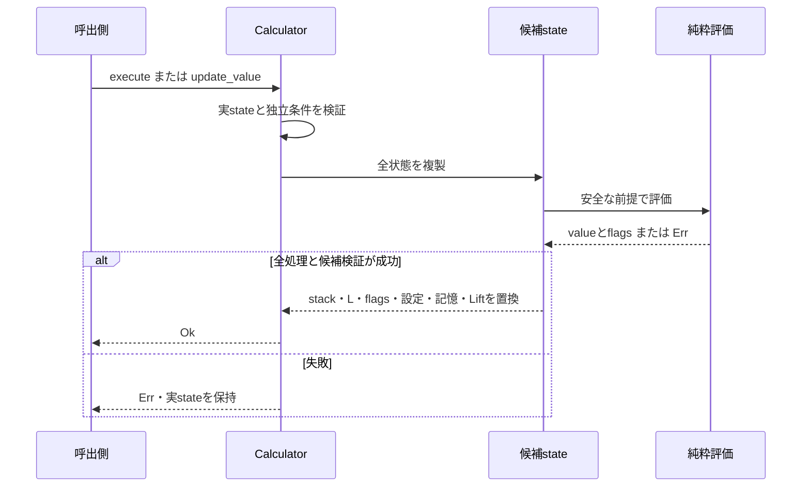

# 07 Calculator・命令実行

版：D-1.0 / 2026-11-14（日本時間）。実装用仕様、製品コードは未実装。

## 1. 対象・根拠・依存

Core calculator/commandの公開窓口、命令効果、原子性を規定する。[IA](../rdp-calc-input-api-design.md)§3・4、[全体設計](../rdp-calc-detailed-design.md)§3.4・4.2・5.2が基準。01～05に依存し、設定変換は12を呼ぶ。入力編集やfinishは09の責務であり、Core単独にはEditingという状態がない。

## 2. 公開API

```rust
pub enum ValueUpdate { Start(Number), ReplaceX(Number) }
impl Calculator {
    pub fn new() -> Self;
    pub fn with_config(config: CalculatorConfig) -> Result<Self, CalcError>;
    pub fn execute(&mut self, command: Command) -> Result<(), CalcError>;
    pub fn execute_all(&mut self, commands: impl IntoIterator<Item = Command>)
        -> Result<(), CalcError>;
    pub fn update_value(&mut self, update: ValueUpdate) -> Result<(), CalcError>;
    pub fn snapshot(&self) -> CalculatorSnapshot;
    pub fn test_bit(&self, index: u8) -> Result<bool, CalcError>;
    pub fn reset(&mut self);
}
```

CalculatorはCloneで独立コピー。newは01のdefault設定、with_configは03の検証・生成。Resultを返さないnew/resetのOS資源枯渇は回復保証外。resetは生成時設定へ戻す。snapshotは03、test_bitはXを検査しboolだけ返し、編集ガードを持たない。

Commandの全variantは次のとおり。Defaultは設けず、数値やindexの任意生成をexecute側で検証する。

```rust
pub enum Command {
    Push(Number), Enter, SwapXY, RollUp, RollDown, RecallLastX,
    Add, Subtract, Multiply, Divide, Remainder, ChangeSign, Absolute, Sqrt,
    And, Or, Xor, Not,
    ShiftLeft, ShiftRight, ShiftRightArithmetic,
    RotateLeft, RotateRight, RotateLeftCarry, RotateRightCarry,
    RotateN(RotateKind),
    MaskLeft(u8), MaskRight(u8), EditBit { index: u8, edit: BitEdit },
    CountBits,
    SetRadix(Radix), SetWordSize(WordSize), SetSignedMode(SignedMode),
    SetOnesZeroMode(OnesZeroMode),
    SetNumericMode(NumericMode), Store(usize), Recall(usize),
    SetFlag { index: u8, value: bool },
    ClearX, ClearStack, ClearRegisters,
}
```

InputDigit/点/EEX/BackspaceをCore Commandへ戻さない。RotateKind/BitEditは05の公開型を参照する。未対応のHP命令をこのenumへ偽装追加せず、CLIのUnsupportedとして扱う。

## 3. 値入力・移動

初期[A,B,C,D]、LAST X=L、旧Liftをlとする。

| 操作 | 数値配列 | 成功後Lift | LAST X・flags |
|---|---|---|---|
| Push(n) | l=Eなら[n,A,B,C]、Dなら[n,B,C,D] | Enabled | 保持 |
| Start(n) | Pushと同じ条件移動 | l保持 | 保持 |
| ReplaceX(n) | [n,B,C,D] | l保持 | 保持 |
| Enter | [A,A,B,C] | Disabled | 保持 |
| ClearX | [+0,B,C,D] | Disabled | 保持 |
| SwapXY | [B,A,C,D] | Enabled | 保持 |
| RollUp | [D,A,B,C] | Enabled | 保持 |
| RollDown | [B,C,D,A] | Enabled | 保持 |
| ClearStack | 全4段を正0 | Disabled | LAST Xを正0、flags保持 |

Push/Start/ReplaceXはすべて02の厳密値検証。幅外を自動マスクしない。ReplaceXは編集状態を前提としない。Liftの有効化自体は値の移動ではない。DisabledでもEnter自身はliftする。

## 4. 演算・記憶・設定の効果

| 命令群 | 配列・保存 | LAST X | Lift |
|---|---|---|---|
| 二項算術、AND/OR/XOR | [result,C,D,D]、Y op X | 元X | E |
| 単項算術、NOT、shift、単項rotate、CountBits | Xだけ置換 | 元X、Float CHSのみ保持 | E |
| RotateN | Yをabs(X)回回転し[result,C,D,D] | 絶対値化前の元X | E |
| MaskLeft/Right、EditBit | X置換、他段保持 | 元X | E |
| Store(i) | Ri=X、配列保持 | 保持 | E |
| Recall(i)、RecallLastX | 元Liftに従う条件lift→X=v | 保持 | E |
| ClearRegisters | 全Riをmodeの正0、配列保持 | 保持 | 保持 |
| SetFlag | 指定F0～5だけ変更 | 保持 | 保持 |
| SetRadix | 配列・raw保持 | 保持 | 保持 |
| SetOnesZeroMode | WordConfigのゼロ処理設定のみ更新 | Keep | 保持 |
| SetWordSize、SetSignedMode、SetNumericMode | 12の全領域更新 | 表現変換のみ、履歴保存なし | 保持 |

RecallLastXはlift前にLをコピーしてvとする。StoreはこのCoreが受け取った現在Xを保存する。セッションはそれに先立ち旧設定でfinishする。Float CHSはCoreでは確定Xの符号反転で、編集例外は09が扱う。演算flagsは04/05の指示を適用し、移動・記憶・値入力はflags保持。

CommandMetadataはlift_effect: Enable/Disable/Neutral、last_x_effect: Keep/SaveX/Clearを持つ内部型。metadata(command,numeric_mode)で分類する。Push/Enter/ClearXは専用経路とし、同じ効果をmetadata適用で二重実行しない。入力終了フラグやphase引数を含めない。

## 5. 検証・更新手順



元X・回数・Carry等は更新前に取得する。純粋評価が成功してから候補内でLAST X、stack、flags、Liftを反映する。候補検証が失敗しても実stateは保持。エラー順位は01。外部API利用者へstateの可変参照や復元手段を出さない。

execute_allはexecuteを順に呼び、最初のErrで停止する。先行成功を巻き戻さない。例：共通状態[5,2,3,4]/L9/EからPush5→Push0→Divide→Push7は[0,5,5,2]/L9/Eで除算失敗、Push7未実行。

## 6. 受入・TBD

IA-C001～016のうち当該命令実装済み部分、TEST-020～031/047/048/055/061を検証する。CoreのIA-C002ではInputInProgressが存在せず、セッションIA-G006では拒否されることを対比する。Enter後PushはLift E、Enter後Start/ReplaceXはD保持。失敗は全Snapshotで比較する。

TBD-001の初期Liftは起動・リセットともD、TBD-011のSTO/RCLは現行契約を採用。TBD-004/006/010/014のHP設定・bit命令を独自APIへ混在させない。未実装命令に依存する試験は持越しとして記録する。
