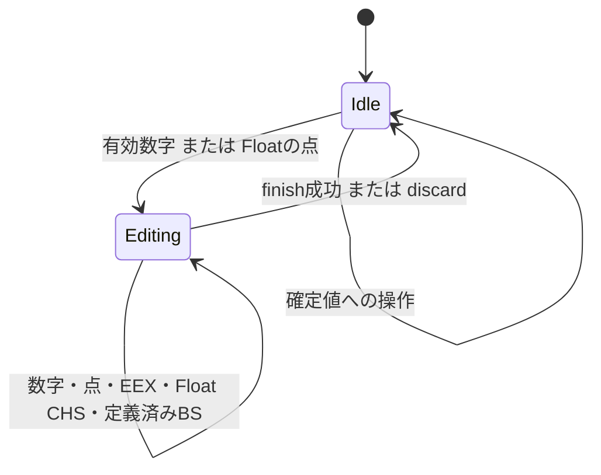

# 08 キー編集器

製品仕様（TBD-017/021、DD-049）：Float編集でBS後に仮数の符号だけが残る場合、bufferを `0`、Xを `+0.0` とし、Editing / MantissaのままLiftを保持する。次の数字は追記する。IA-G012（旧SI-H003）を製品受入試験に含める。

版：D-1.0 / 2026-11-14（日本時間）。キー入力の製品規則。

## 1. 対象・根拠・依存

rdp-input内部のInputState、edit、finishを規定する。[SI](../rdp-calc-stack-input-detailed-design.md)§2・6、[IA](../rdp-calc-input-api-design.md)§3・4が根拠。01/02とCore Snapshotへ依存し、stack移動・Core呼出し・成功時置換は09が担当する。CLIの完成数値解析（10）を流用しない。

## 2. 型・所有・API

```rust
pub enum EntryPhase { Idle, Editing }
pub enum EntryPart { Mantissa, Exponent }
pub enum Key { Digit(char), DecimalPoint, Exponent, Backspace, ChangeSign }
#[derive(Clone)]
struct InputState { phase: EntryPhase, buffer: String, part: EntryPart }
fn edit(input: &mut InputState, key: Key, config: &CalculatorSnapshot)
    -> Result<Number, SessionError>;
fn finish(input: &mut InputState, config: &CalculatorSnapshot)
    -> Result<Number, SessionError>;
```

InputStateと関数はInput crate内部。config引数は旧設定を含む読取Snapshotで、書換え先ではない。editの成功は候補buffer/phase/partとpreview値、finishの成功は完成値とIdle化。失敗は入力を保持し、外側のセッションも全体を保持する。

Idleはbuffer空・part=Mantissa、EditingはASCII 1～256文字、合法な編集文法、Core X=preview(buffer)。Integerは常にMantissa。文字列を正本とし、編集前の確定Xを別の永続フィールドへ保存しない。

## 3. 開始・数字・Integer

Digitは基数に合うASCIIのみ。BIN=0/1、OCT=0～7、DEC=0～9、HEX=0～9/A～F（小文字を大文字化）。Digit('-')、全角、G等はInput(InvalidDigit { digit, radix })。有効な候補文字列とpreviewを作ってから09へ渡し、不正初回桁で先にliftしない。

Idle数字はその桁から新規bufferを作る。Editing数字は末尾へ追記し、先頭ゼロを保持する。DECは数学値範囲を厳密検査、BIN/OCT/HEXは符号なしraw範囲を検査し、幅超過はCalculation(IntegerOutOfRange)。例：W8 Twos HEXのFFはrawFF、DECの128は初回・継続とも拒否する。

Integer CHSは文字列への負号付加ではない。09がfinishしてCore ChangeSignへ送る。次の数字は新規入力となる。Integerの点/EEXはCalculation(NumericModeMismatch)。

## 4. Floatの編集文法

FloatはDECのみ。仮数は`-?digits(.digits*)?`、その後に省略可能な`e-?digits*`。Idleの点は`0.`で開始する。点は仮数で1度のみ。EEXは仮数数字があり、既存指数がない場合だけ受理する。

| 操作・条件 | 規則 |
|---|---|
| Idle EEX | Input(IncompleteEntry) |
| 2個目の点、指数部の点、2個目のEEX | Input(InvalidNumber) |
| Editing CHS | 現partの先頭負号を切替え、編集を継続 |
| buffer末尾e/e- | 編集中のみ受理、previewでは指数0として解釈 |
| finishで末尾e/e- | Input(IncompleteEntry)、previewを確定値にしない |
| 有効文法だが非有限preview/完成値 | Calculation(FloatingPointOutOfRange) |

CHSで仮数`0`は`-0`になり、f64符号bitを保持する。`1e2`の指数CHSは`1e-2`。FloatのIdle CHSはeditを呼ばず09からCoreへ送る。HPの仮数10桁・指数2桁を本製品のf64/256文字へ暗黙適用しない。



これは入力phaseの射影。mode、文法、範囲、失敗、Liftのガードは本書・09の表を適用する。失敗時にはphaseも移動しない。

## 5. Backspace・長さ

Editing BSは末尾1文字を削除し、空なら`0`へ正規化する。指数記号を削除したらpart=Mantissa、残っていればExponent。再解析してpreviewを返し、追加liftは行わない。`12→1`、`1→0`、`1e-2→1e-→1e→1`、その後の数字追記`0→02`を保持する。Idle BSは09でClearXへ送る。

Floatの `-1` でBSを押すと `0` に正規化する。Xは正のゼロとなり、編集を継続する。

符号・点・eを含むASCII buffer全体が上限256文字。候補257文字はInput(InputTooLong)、256文字の先頭ゼロは受理可能。CHSの負号追加も長さ検査対象。値範囲が先に超えれば範囲エラー。削除・符号切替でも有限性を再検査し、bufferだけ先に更新しない。

## 6. finishとエラー

finishは旧mode/radix/WordConfigで完成値を再解析し、成功ならbuffer空、phase=Idle、part=Mantissa。Core Xへの採用は09のReplaceXで行い、finish単体はCoreに触らない。Idleではセッションがfinishを省略し、未編集Xを再解析しない。

エラー順位は01。仮数の符号だけが残るBSには§5の正規化を適用する。一般の不正文法、桁、未完成、長さはInput、値域・mode不適合はCalculationへ分類する。

## 7. 受入・TBD

SI-T027～040/045～052/073/074、TEST-032～038、IA-G002/003/005/007を単体・統合へ配置する。Floatはto_bitsで±0を区別し、長さ境界は先頭ゼロで数値範囲の影響を避ける。

TBD-013では初回桁にも継続桁と同じ幅検査を行う。拒否時はX・buffer・Lift・flagsを含む全状態を保持する。TBD-017/021の編集規則はCLIのkeysと将来GUIで共用する。
