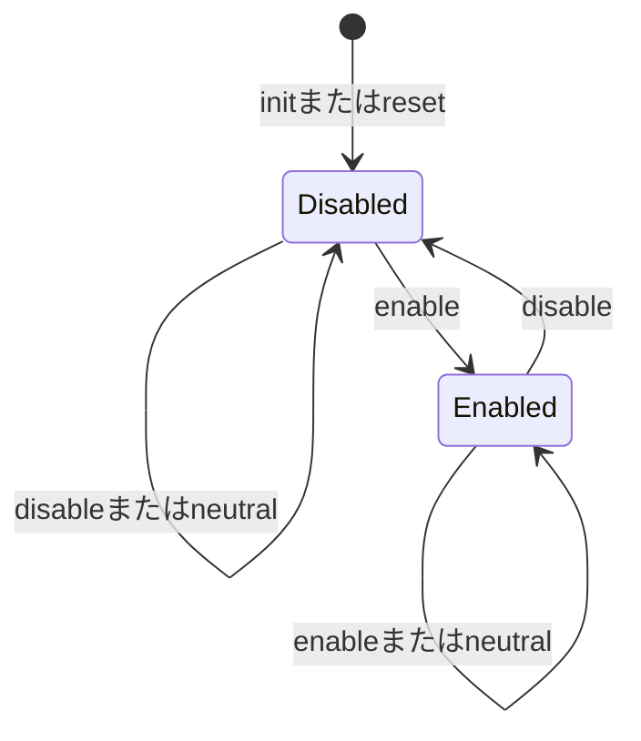
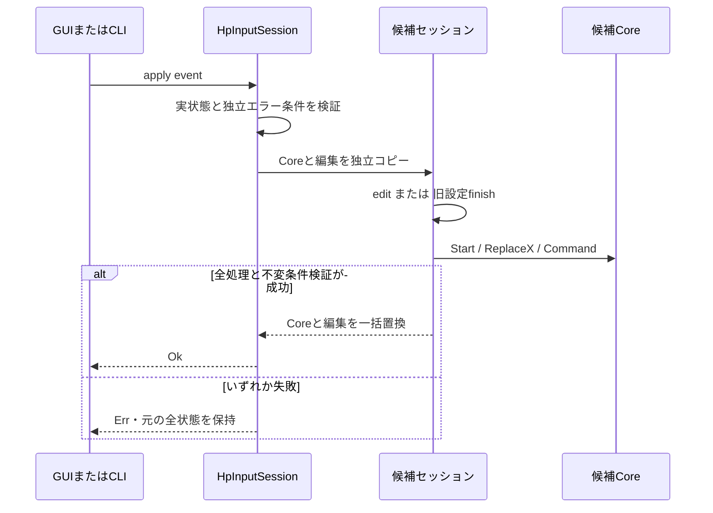

# 09 入力セッション

2026-11-21 製品仕様（TBD-021 / DD-049）：Float編集でBS後に仮数の符号だけが残る場合、bufferを `0`、Xを `+0.0` とし、Editing / MantissaのままLiftを保持する。次の数字は追記する。IA-G012（旧SI-H003）を製品受入試験に含める。HP実機との照合はTBD-017で継続する。

版：D-1.0 / 2026-11-14（日本時間）。実装用仕様、製品コードは未実装。

## 1. 対象・根拠・依存

rdp-inputのHpInputSessionが編集器08とCore07を協調更新する契約を定める。[IA](../rdp-calc-input-api-design.md)§3～5、[SI](../rdp-calc-stack-input-detailed-design.md)§5・10が正本。Calculatorの可変参照を外部へ出さず、Core＋InputStateを所有する。GUIも同じセッションを利用する。

## 2. 公開API・Snapshot

```rust
#[derive(Clone)]
pub struct HpInputSession { calculator: Calculator, input: InputState }
pub enum InputEvent { Key(Key), Command(Command) }
pub enum SessionError { Input(InputError), Calculation(CalcError) }
pub struct InputSnapshot {
    pub calculator: CalculatorSnapshot,
    pub entry_phase: EntryPhase,
    pub input_buffer: Option<String>,
    pub entry_part: EntryPart,
}
impl HpInputSession {
    pub fn new(calculator: Calculator) -> Self;
    pub fn apply(&mut self, event: InputEvent) -> Result<(), SessionError>;
    pub fn snapshot(&self) -> InputSnapshot;
    pub fn test_bit(&self, index: u8) -> Result<bool, SessionError>;
    pub fn reset(&mut self);
}
```

newはCalculatorの値・Liftをそのまま引き継ぎ、編集だけIdle/空/Mantissa。Clone/Snapshotは独立コピー。input_bufferはIdleでNone、EditingでSome(buffer)。resetはCoreの生成時設定復元と編集破棄を一緒に行う。

## 3. 分岐と遷移

lは旧Lift E/D。全行は検証・評価成功時だけ適用。4状態I_D/I_E/E_D/E_EはphaseとLiftの直積であり、新しい4値enumへ変更しない。

| SI分類 | 受理イベント・前提 | 処理 | 次phase / Lift |
|---|---|---|---|
| SI-01/02 | Idleの有効数字/Float点 | edit→Core Start(preview)、旧Liftで条件移動 | Editing / l |
| SI-03/04 | Editing数字/Float点・EEX | edit→ReplaceX、再liftなし | Editing / l |
| SI-05/06 | Enter | Editingならfinish→ReplaceX、その後Core Enter | Idle / D |
| SI-07 | ClearX | finishせず編集破棄＋Core ClearX | Idle / D |
| SI-08 | 通常演算/Swap/Roll | 編集中ならfinish→ReplaceX、その後Core実行 | Idle / E |
| SI-09 | Float Editing CHS | edit→ReplaceX、L保持 | Editing / l |
| SI-10 | Integer CHS / Float Idle CHS | Integer編集ならfinish→ReplaceX、Core ChangeSign | Idle / E |
| SI-11 | Editing BS、定義済み境界 | edit→ReplaceX | Editing / l |
| SI-12 | Idle BS | Core ClearX | Idle / D |
| SI-13 | 基数/幅/補数/flag設定 | 旧設定finish→ReplaceX、その後Core設定 | Idle / l |
| SI-14 | 数値mode設定 | 旧設定finish→ReplaceX、その後全値変換 | Idle / l |
| SI-15 | Recall/RecallLastX | finish→ReplaceX、その後Core条件lift格納 | Idle / E |
| SI-16 | Store | finish→ReplaceX、その後現在X保存 | Idle / E |
| SI-17 | Idle Push | Core Push | Idle / E |
| SI-18 | Editing Push | InputInProgress、変更なし | 元phase / l |
| SI-19 | ClearStack | finishせず編集破棄＋Core ClearStack | Idle / D |
| SI-20 | ClearRegisters / snapshot | Core記憶だけクリア / 読取だけ | 元phase / l |
| SI-21 | 任意の失敗 | 候補全体を破棄 | 元phase / l |

finishはEditing時だけ行う。Idleの同じイベントはCoreへ直行する。InputEvent::Command(ChangeSign)もKey::ChangeSignと同じmode/phase分岐に統一する。test_bitは編集を終えず、EditingならInputInProgress、IdleならCoreへ委譲する。独立Core条件との競合は01/IAの順位に従う。



disable={05,06,07,12,19}、enable={08,10,15,16,17}、neutral={01,02,03,04,09,11,13,14,18,20,21}（SI接頭辞省略）。08の入力phase図と同じイベントへ同時適用する。NeutralでもSI-01は実際にliftし得る。図のinitは新規Calculatorの生成、既存Calculatorからセッション生成した場合は旧E/Dを保持する。

## 4. 原子性・処理順序



成功後は08の編集不変条件と03のCore不変条件を満たす。finish時に再liftしない。設定変更はfinishを旧設定で行い、新基数でbufferを再解釈しない。演算失敗時には入力確定も取り消す。

独立Core条件を先に比較する。Float Editing("1e")＋SetRadix(HEX)はCalculation(NumericModeMismatch)、同buffer＋DivideはInput(IncompleteEntry)。後者では未完成previewを除数として使わない。

## 5. 復帰・受入・TBD

ErrでCore全Snapshot、phase/buffer/partを保持する。エラー表示状態や次キー消費状態を追加しない。Editing("0")でDivide失敗後Digit2はEditing("02")を継続し、新規数値を望む場合はClearXを明示する。

SI-T001～076を必要命令実装後にセッション統合試験として引き継ぎ、IA-G001～010、TEST-029とIA-C002の対比を確認する。全成功・失敗で4段/L/flags/設定/記憶/Lift/編集を検査。SI-H004はIA-G004へ移管済みで二重集計しない。

TBD-001/011の現行契約を維持し、TBD-012のHP解除キー、013のHP桁境界、017/021の編集保留を解決済みにしない。未定義BS分岐は08の実装ゲートに従う。
