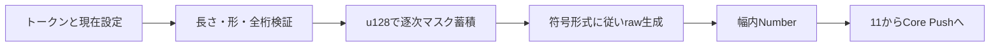

# 10 CLI数値トークン解析

版：D-1.0 / 2026-11-14（日本時間）。CP-01/02/03確定反映。

## 1. 範囲・根拠・依存

rdp-cliの完成数値トークン解析を定める。[IA](../rdp-calc-input-api-design.md)§2・3・4が正本。01/02へ依存する純粋解析で、Calculatorを呼ばない。トークンの命令識別と実行は11、HPキー編集は08が担当する。

## 2. 型・API

```rust
pub(crate) struct ParseContext {
    radix: Radix, mode: NumericMode, word_config: WordConfig,
}
pub(crate) enum LiteralError {
    InputTooLong, InvalidDigit { digit: char, radix: Radix },
    InvalidNumber, FloatingPointOutOfRange,
}
pub(crate) fn parse_literal(text: &str, context: ParseContext)
    -> Result<Number, LiteralError>;
```

ParseContextはそのトークン位置まで命令を実行した現在設定。FloatならDecimal等、Core由来の有効設定を前提とする。入力文字列や設定を変更せず、成功はNumber、失敗はLiteralErrorのみ。Core Pushが後で独立した値検証を行う。

## 3. 文法とエラー順

前後ASCII空白を除く1トークンを対象とし、除去後の符号・接頭辞込みで最大256バイト。内部空白、空、符号重複・位置違い、桁なし接頭辞を拒否する。

1. 長さ超過をInputTooLong。
2. 符号・接頭辞・桁存在の形不正をInvalidNumber。
3. 整数の数字列を左から検査し、最初の不正文字をInvalidDigit { digit, radix }。
4. Float文法と有限変換を検査する。

整数は先頭に任意の`+/-`、続いて任意の`0b/0o/0d/0x`（大小文字可）、1桁以上の適合数字。接頭辞省略は現在radix。接頭辞で表示radixは変更しない。underscore・全角・基数外文字は数字列でInvalidDigit、内部空白はInvalidNumber。

単独`-`は全modeで正0へ変換する特例。明示`-0`は別扱い。単独`+`はパーサー単体ではInvalidNumber、命令識別ではAdd。CLIの減算語はsubで、keys内の減算キーは従来どおり。

## 4. 整数の表現ビット列化

W=1～64、M=2^W−1。絶対値の各桁をu128で`a=(a*base+digit)&M`として蓄積する。各段階a≤u64::MAX、base≤16なので積はu128内。全桁をi128へparseしてから切り捨てる方式を使わない。

| 符号・形式 | raw |
|---|---|
| 非負、全形式 | a |
| 負、Unsigned/Twos | (2^W−a)&M |
| 負、Ones | M xor a |

Onesは数学値modではなく、絶対値の表現ビットを反転して下位Wbitを採る。Unsigned負数も受理し表示は非負になり得る。入力はflagsを変更しない。



W64で2^64を必要とする計算はu128を使い、1u64<<64を避ける。マスクしていても全桁を検証し、上位部分の不正文字を無視しない。

## 5. Float・負0

十進文法は`[+-]?((digits(\.digits*)?)|(\.digits+))([eE][+-]?digits+)?`。整数の接頭辞・マスクを適用しない。NaN/Inf、16進Float、underscore、全角、不完全指数はInvalidNumber。文法上正しい1e999等の非有限変換はFloatingPointOutOfRange。有限subnormalとunderflowによる0は受理する。

`-0`はUnsigned/Twosでraw0、OnesでrawM、Floatで-0.0。単独`-`はそれぞれ正0。Onesで無符号表記rawMも負0として解釈される。

## 6. 受入・境界

IA-L001～016のparse単体を引き継ぐ。W8 HEX 0x12/123/1FF/100はraw12/23/FF/00。DEC -123はTwos/Unsigned=85、Ones=84（rawはHEX）。W64最大値とその次、符号境界、256/257文字を独立した多倍長参照式で確認する。

0xG/0b2/0o8はInvalidDigit、0x/--1/0d-1/内部空白はInvalidNumber、1_0/全角１は整数parse単体でInvalidDigit。257文字＋末尾GはInputTooLong。Float 1e-はInvalidNumberで、HP編集のIncompleteEntryとは異なる。

解析失敗でCore呼出し0回・pending不変を11のspy/統合試験で確認する。CLIの下位Wビット採用とキー入力の厳密拒否（TBD-013）を同じ幅外値で比較する。
