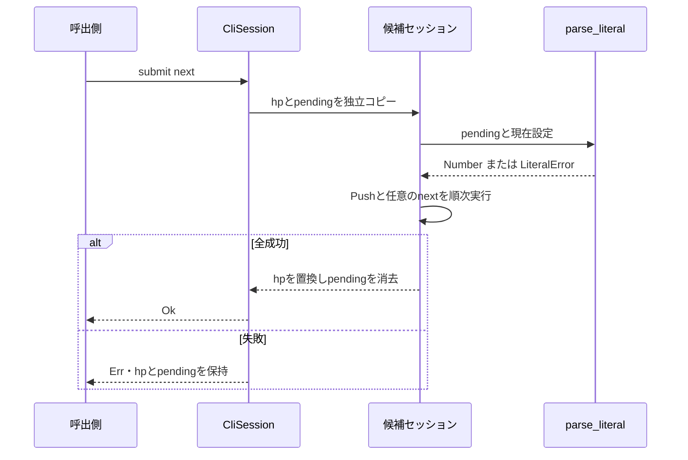

# 11 CLI構文・実行・入出力

版：D-1.0 / 2026-11-14（日本時間）。実装用仕様、製品コードは未実装。

## 1. 対象・根拠・依存

rdp-cliのargs/parser/session/repl/batch/output/errorを規定する。[全体設計](../rdp-calc-detailed-design.md)第9章、[IA](../rdp-calc-input-api-design.md)§2～5が基準。06の表示、07のCore、09のセッション、10の数値解析を利用する。mainは起動・接続・診断・最終終了コードを決め、計算処理を持たない。

## 2. 所有・型・API

```rust
pub(crate) struct CliOptions {
    pub(crate) config: CalculatorConfig,
    pub(crate) expression: Option<String>,
}
pub(crate) enum ParsedAction {
    Command(Command), Literal(String), Keys(Vec<InputEvent>),
    TestBit(u8), ShowStack, ShowStatus, Help, Exit, Unsupported(String),
}
pub(crate) enum CliError {
    UnknownCommand(String), MissingArgument(String), InvalidArgument(String), LineTooLong,
}
pub(crate) enum CliRuntimeError {
    Syntax(CliError), Literal(LiteralError), Input(InputError),
    Calculation(CalcError), Io(std::io::Error),
}
pub(crate) struct CliSession { hp: HpInputSession, pending: Option<String> }
pub(crate) enum RunControl { Continue, Exit }
```

ReplはCliSessionを所有する。CliSessionはHpInputSessionと未確定のCLI数値pendingを所有し、HP Editingとpendingの同時保持を禁止する。切替要求はInputInProgressとして全状態を保持する。

| API | 契約 |
|---|---|
| parse_args(args) -> Result<CliOptions,CliError> | 起動設定と最大1個の式引数を解析、状態なし |
| parse_line(&str) -> Result<Vec<ParsedAction>,CliError> | 行全体の構文を先に検査。Literalは文字列保持 |
| CliSession::submit(next: Option<Command>) -> Result<(),CliRuntimeError> | pending解析→Push→任意の後続命令を候補上で実行し一括確定 |
| run_actions(&mut CliSession,actions,&mut Write,interactive) -> Result<RunControl,CliRuntimeError> | 逐次実行、最初の失敗で停止、先行成功保持 |
| Repl::new(Calculator)、run(&mut BufRead,&mut Write,&mut Write) | 行間で状態保持、通常の失敗は診断して次行へ、IoのみErrで終了 |
| run_batch(CliOptions,&mut Write) -> Result<(),CliRuntimeError> | 起動・式・末尾完全性検査後、最終Xだけ出力 |
| render_x/stack(&InputSnapshot) -> Result<String,CalcError> | 06へ委譲。stackはT/Z/Y/X順にラベル |
| render_status(&InputSnapshot) -> String | mode/radix/width/signed/F0～5/phase/lift/個数 |
| exit_code(&CliRuntimeError) -> u8 | Syntax/Literal=2、Input/Calculation=1、Io=3 |

I/Oは借用した標準traitで差し替え可能とし、グローバル端末に固定しない。全体設計の関数シグネチャを維持し、既存型にDefaultを追加しない。

## 3. 起動・行構文

式なしはREPL、式ありはワンショット。`--help`はmainの別経路で終了0。オプションは`--base {bin,oct,dec,hex}`、`--word-size N`、`--signed {unsigned,ones,twos}`、`--float`、`--register-count N`。Nは十進。欠落・重複矛盾・不正値はSyntax。Float基数未指定はDEC、明示非DECは拒否する。

行は最大64KiB、数値はASCII、入出力文字コードはUTF-8。読み込みを上限+1までに抑え、超過分を改行まで捨ててLineTooLong。空行は無処理。ASCII空白でトークンを区切り、引用符外のトークン境界`#`以降はコメント。シェルコード実行機能は持たない。

| トークン群 | 意味 |
|---|---|
| hex/dec/oct/bin、wsize N、signed unsigned/ones/twos、integer/float | 独自の直接設定API |
| +、*、/、%、add/sub/mul/div/rmd、chs/abs/sqrt | 算術。通常CLIの単独-は数値正0 |
| and/or/xor/not、sl/sr/asr/rl/rr/rlc/rrc、rln/rrn/rlcn/rrcn | 論理・シフト・回転 |
| maskl N/maskr N、sb N/cb N、popcount | 独自引数式bit命令、CountBits |
| enter/swap/rollup/rolldown/lastx、sto N/rcl N | stackと記憶 |
| sf N/cf N、clx/clearstack/clearregs | flagとクリア |
| keys "..." | キー列、再ネスト不可 |
| bit? N、stack/status/help/exit | REPL専用の照会・制御 |

コマンド名は大小文字を区別しない。命令引数Nは十進で、固定の文法範囲と型への収容をparse段階で検査する。実行時Wやレジスタ個数に依存する範囲はCoreで検査する。wsizeは1～64、maskは0～64かつ実行時W以内、flagは0～5。

予約語を数値より優先する。数値接頭辞付きトークン、符号付き数字、全体がHEX数字のトークンはLiteral候補として現在設定で10へ送る。全体設計の数値候補規則を維持し、`G`単独等の他の未知語はUnknownCommand。`0xG`は必ずLiteral候補となりLiteral(InvalidDigit)。Float候補には小数点・指数を含む十進数値文法の候補も含め、未完成指数はLiteral(InvalidNumber)にする。

known unsupportedはlj/dblmul/dbldiv/dblr/wsize-x/run/label/goto/call/rtn。構文時にUnsupportedへ分類し、実行時Calculation(UnsupportedOperation)。未知語のSyntaxとは区別する。

keys内は数字片を1文字ずつKey::Digitへ展開し、数字片の間に自動ENTERしない。`keys "1 2"`は12。`digit:X`、`.`、eex、bs、chsを受理し、文字EはDigit('E')、eexだけExponent。数値片の符号・接頭辞を禁止し、符号はchs、基数は外側で指定する。keys内の`-`は減算Command。桁の現在基数適否は実行時検査。

## 4. 実行と原子性

parse_lineは行構文全体を検査し、Syntaxならその行の命令を一切実行しない。Literalの内容はこの段階で数値化せず、`hex FF dec 10 +`は各位置の現在設定で解析し結果265となる。

通常のLiteralは現在設定でparse_literal→InputEvent::Command(Push)とし、通常実行のために永続pendingを作らない。Commandはsubmit(Some(command))へ渡し、pendingがなければその命令だけを実行する。Keysは各イベントを順にapplyする。通常トークン列全体・Keys全体を一括ロールバックしない。後続失敗では先行イベント成功を保持する。

pendingは別途ステージされたCLI数値を後続命令と一括確定する内部機構。セット・置換・取消しのUIを今回新設しない。pendingがある状態からKeysへ切り替える、またはHP Editingからpendingをセットする要求はInputInProgressで拒否する。通常のLiteral経路もHP Editing中の完成値Pushを許可しない。テストではcrate内部からpendingを構築してsubmitの契約を検証する。



pendingがNoneなら解析/Pushを省き、nextがあればその命令だけ実行する。両方Noneは変更しない。二重編集禁止と実不変条件の検査後、pendingの解析失敗ではCoreを呼ばない。公開状態を変更する前に候補内で処理する。

共通初期[5,2,3,4]/L9/Eでpending=0、next=DivideはPushも取り消して元配列とpending=0を保持。一方、通常`5 0 /`は[0,5,5,2]/L9/Eで除算だけ失敗する。Core execute_allも後者の先行成功保持であり、submitの代用にしない。

## 5. 出力・終了・末尾編集

ワンショットはShowStack/ShowStatus/Help/Exit/TestBitを全actionsの実行前検査でInvalidArgumentとして拒否し、stdoutを最終X＋改行の1行に限定する。失敗Batchは最終Xを出さずstderrへ診断する。正常終了0、エラーは上表の分類。外部スクリプトはこの入出力と終了コードを利用し、別起動間で計算状態を共有しない。

Batch末尾のHP EditingはHP finishの完全性・厳密範囲で検査し、ENTERを挿入しない。CLIからprivate finishを直接呼ばず、現在radixと同じSetRadixをセッションへapplyする実装経路を用いる。これは既存の「同一基数でも旧設定finish、L/flags/Liftと値を保持」の契約を利用する具体化で、public API追加は不要。不完全指数ならInput(IncompleteEntry)、成功なら編集を終えて数値だけ表示する。

REPLはSyntax/Literal/Input/Calculationの診断後に次行を処理し、正常exit/EOFは0。Ioのみ終了Err。正常の通常計算行でXを表示し、編集中はbufferを併記する。照会はその結果を表示、Exit以降は未実行。REPL出力を外部自動化用の固定プロトコルとしない。表示レイアウトの細部は実装時に代表例を記録し、演算合否とは分ける。

## 6. 受入・残件

TEST-053/054/056/060/064、IA-L017～022、IA-G011。行構文失敗の全未実行、通常実行の先行成功保持、pending一括取消、現在基数での解析、終了コード、二重編集禁止、末尾e/e-拒否を検証する。入力解析失敗はCore呼出し0回。入出力失敗はIo=3。

TBD-012/018のUI・表示互換を本単位で確定しない。HP内蔵プログラミングは対象外。未対応語として認識することは将来実装の約束ではない。
