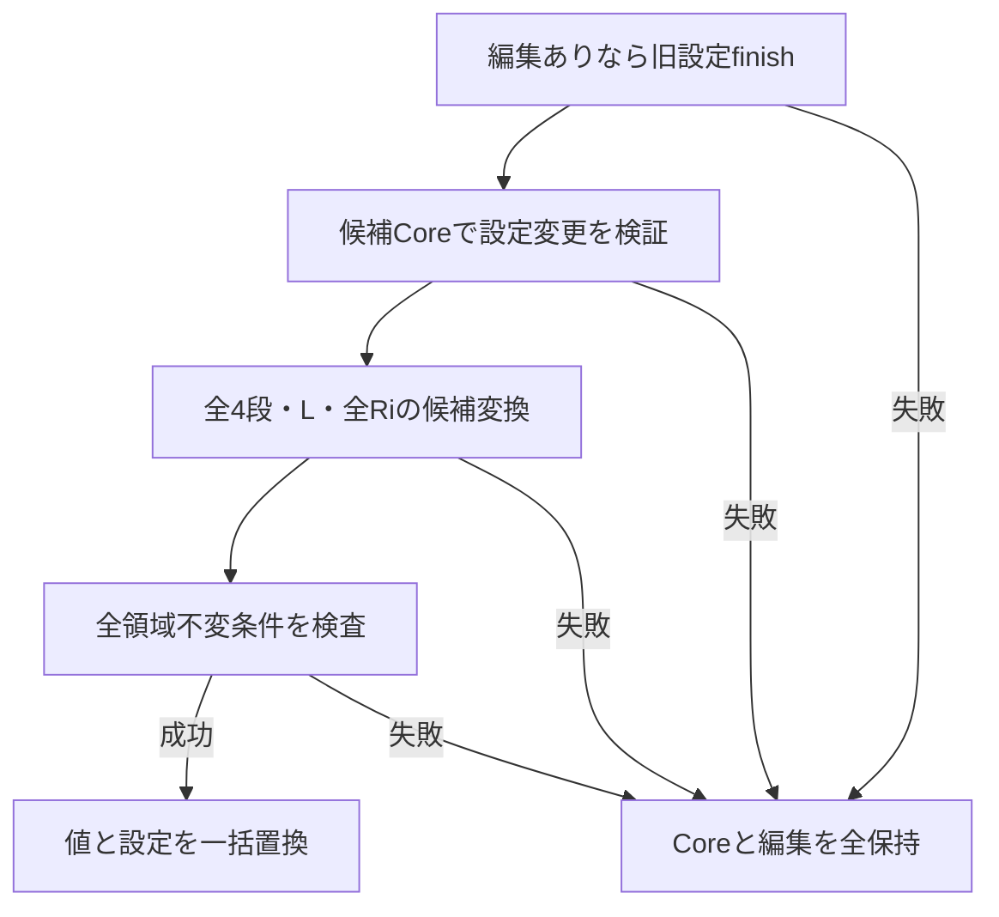

# 12 設定変更・全領域変換

版：D-1.0 / 2026-11-14（日本時間）。独自直接APIの暫定変換と実機仕様を分離する。

## 1. 対象・根拠・依存

Core stateの設定変更、全4段/LAST X/全Riの表現変換を規定する。[全体設計](../rdp-calc-detailed-design.md)§4.4・5.2・7.7、[SI](../rdp-calc-stack-input-detailed-design.md)§6.3、[IA](../rdp-calc-input-api-design.md)§3・4が基準。01～03に依存、07から呼出し、09は旧設定finishを先に行う。

## 2. APIと対象領域

CalculatorState内部の`reconfigure_word(&mut self,next: WordConfig) -> Result<(),CalcError>`、`convert_mode(&mut self,next: NumericMode) -> Result<(),CalcError>`を用い、公開窓口はCommandのSetWordSize/SetSignedMode/SetNumericMode/SetRadixとする。

処理対象順はX/Y/Z/T/L/R0以降。全領域を検証・変換した候補を作り、1値でも失敗すれば設定・値・flags・Liftを含め元状態を保持する。LAST Xも変換対象であり、「履歴として元Xを新たに保存する」とは異なる。

## 3. 基数・幅・補数形式

| 命令 | 成功時の効果 | 不適合 |
|---|---|---|
| SetRadix | 数値raw・L・flags・Lift保持、表示基数だけ変更 | Floatの非DECはNumericModeMismatch |
| SetWordSize | 全4段/L/Riを縮小なら低位保持、拡大ならゼロ拡張 | FloatではNumericModeMismatch |
| SetOnesZeroMode | 全値・flags・Liftを保持し、算術のゼロ処理設定のみ更新 | 全数値モードで可 |
| SetSignedMode | 全raw保持で数学値解釈だけ変更 | FloatではNumericModeMismatch |

幅変更のflags/LiftはKeep。Twos負値も幅拡大で符号拡張しない。W8 rawFF→W16 raw00FFであり、数学値−1を保持する変換ではない。幅縮小後に戻しても捨てたbitは復元しない。同じ幅・符号・基数の指定でも、セッションでは旧編集をfinishする。

幅・補数変更のLAST Xは表現の更新だけで履歴保存なし。TBD-004のスタック幅規則は資料確認済み、L/記憶領域へ同じ規則を適用する方式は独自暫定。現在Vec<Number>は実機raw storage再配置を再現しない。

## 4. Integer→Float

元WordConfigで全値の数学値と負0を解釈し、f64で厳密に保持できる整数だけ受理する。有限であっても丸めによる情報欠落はIntegerOutOfRange。Ones負0は-0.0。他の0は+0.0。

u64最大値はf64で2^64へ丸まり厳密変換不能。9007199254740993も拒否する。一方、2^53より大きい値でも2の冪等の厳密表現可能値は受理し、単純な「2^53超は全拒否」としない。

f64から元整数へ戻す検証では、先に広い型・厳密な境界で範囲を確認する。`as u64`の飽和によりu64最大値が往復一致したように見える実装を禁止する。

## 5. Float→Integer

全値が有限、整数値、対象形式の数学値域内で、符号化した整数との往復で同じ数学値となる場合だけ受理。小数部の丸め・切捨てを行わない。非整数/範囲外/厳密性欠落はIntegerOutOfRange。非有限入力はFloatingPointOutOfRangeだが、実stateに非有限が存在する内部破損ではInvariantViolationを優先する。

- -0.0はOnesでrawMの負0、Unsigned/Twosでraw0。
- +0.0は全形式でraw0。
- Unsignedは負の非0を拒否する。CLI負数のmod規則を適用しない。
- W1 Onesは±0のみ。W64 Unsignedの上限2^64−1はf64上の2^64と同一視しない。

## 6. 共通のmode切替効果

異なるmodeへの成功時はradix=Decimal、WordConfig保持、F0～5保持、Lift保持。LAST Xも数値変換して保持する。全レジスタの変換を含める。同一mode指定は値・radixを変更せず、セッションの入力終了だけ行う。

負0の変換は上記の明示規則を優先し、Unsigned/Twosへ戻るときの符号喪失を許容する。この場合にf64のbit往復一致を機械的に要求して拒否しない。

## 7. 実機APIとの差

| 現行独自API | 実機の別動作・残件 |
|---|---|
| SetWordSize(WordSize) | HP WSIZEはabs(X)、0→64、Drop、元XをL保存。記憶領域はraw保存・境界再配置 |
| SetNumericMode(Float) | HP FLOATはX=Y×2^X、Y/Z/T/L=0、W56、Lift E、記憶領域の数値変換なし |
| Float SetRadix(nonDEC)拒否 | 実機の整数復帰キーを再現するなら新しいCommand設計が必要 |

これらは同じAPIの別オプションとして暗黙切替しない。HP FLOATのTEST-072とSI-H005は実機との差を記録する参考例とする。HP WSIZEのTEST-071とSI-H006はTBD-004/014で継続する。

## 8. 受入・TBD

TEST-039～042/061、SI-T041～044/053～060/075、IA-C010、IA-G004、SI-T056。R0だけが変換不能な場合にも、4段/L/全Ri/設定/flags/Lift/編集を全保持する。旧HEXのAをDECへ変更して10を保持し、新基数で再解析しない。

TBD-006は§4～6の厳密な全領域変換で確定。幅変更における記憶領域の扱いはTBD-004で継続する。f64演算精度のTBD-016、編集の017/021と区別し、既存HP保留を成功へ昇格しない。
