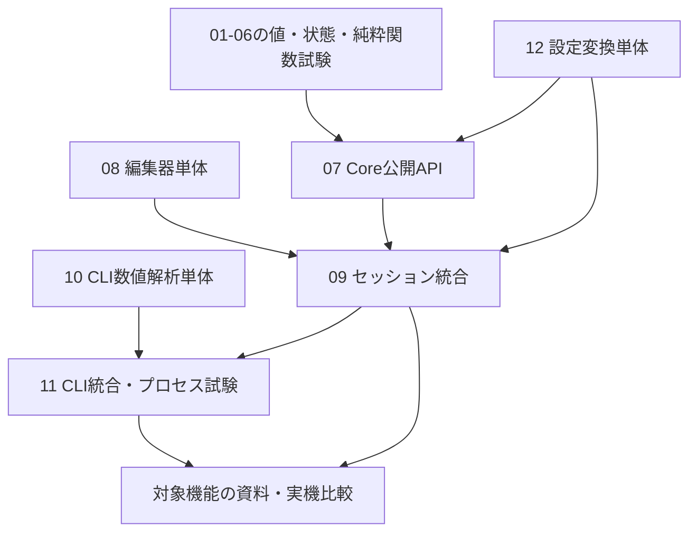

# 13 結合試験・互換性評価

2026-11-21 製品仕様（TBD-021 / DD-049）：Float編集でBS後に仮数の符号だけが残る場合、bufferを `0`、Xを `+0.0` とし、Editing / MantissaのままLiftを保持する。次の数字は追記する。IA-G012（旧SI-H003）を製品受入試験に含める。HP実機との照合はTBD-017で継続する。 現在の集計はResolved 7 / Partial 11 / Open 4。以下の旧集計・保留記述は決定前の記録。

版：D-1.0 / 2026-11-14（日本時間）。本書は受入仕様であり、製品試験の実行結果ではない。

## 1. 目的・根拠

00～12をまたぐ受入条件、既存ケースの継承、暫定・互換・保留の区分を定める。[全体設計](../rdp-calc-detailed-design.md)第10～12章、[試験仕様](../rdp-calc-stack-input-test-cases.md)第7～9節、[TBD一覧](../rdp-calc-tbd-list.md)、[照合記録](../rdp-calc-manual-review.md)が基準。各単位のテストはその単位と一緒に実装し、本書まで延期しない。

## 2. 試験配置・依存

この図は試験前提の関係。全機能が完成するまでCore基本試験を待つ意味ではない。Integer基本経路→bit/1補数→Float/設定変換と、実装済み部分から段階的に実施する。

private状態の検査は所有モジュール内、Core公開試験はcrates/rdp-core/tests、セッション公開試験はcrates/rdp-input/tests、CLI試験はcrates/rdp-cli/tests。tests/scenariosは共有データ。予定コマンドは`cargo test -p rdp-core`、`cargo test -p rdp-input`、`cargo test -p rdp-cli`。現時点の雛形でこれらが通るとは主張しない。

## 3. 既存IDの継承・移設

| ケース | 仕様・実行先 |
|---|---|
| TEST-001～019、flags/word/算術 | 01～05、Core単体。Numberで値を構築 |
| TEST-020～038のキー操作 | 08/09、InputEventへ移設。旧InputDigit等のCore APIを復活させない |
| TEST-029、SI-T024 | Editing Push拒否はセッション。直接Core IA-C002とは別経路 |
| TEST-032のCLI 0xG | 10/11、IA-L012と対応。キーInvalidDigitとは層を分ける |
| TEST-039～043、Float/変換関連 | 06/12とセッション・CLI対応部分 |
| TEST-047/048、IA-C013、IA-L018～020 | 原子性範囲の対比。単発全取消と先行成功保持を分ける |
| TEST-053/054/056/060/064 | 11とIA-L群、プロセス・I/O・外部自動化 |
| TEST-065～067/071/072 | 未確認互換・精度差・将来HP APIの該当範囲を保留管理 |
| SI-T001～076 | セッション統合としてIDと数値期待値を保持。必要Core命令成立後に実行 |
| IA-L001～022 | CLI parse単体と実行を分ける。L017以降は11の依存が必要 |
| IA-C001～016 | Core APIと内部順位・破損fixture。公開注入APIを増やさない |
| IA-G001～011 | GUI相当の共通入力とCLI協調。G012は通常合格対象外 |

旧IDを削除・再利用しない。同じ実行ケースに主IDを1つ付け、旧IDを追跡タグとして残す。範囲対応は元fixtureの初期条件を変更する許可ではない。例：SI-T070は初期Lift D、IA-C013はEなので、Push列が同じでも最終配列が異なる。

## 4. 比較する状態・網羅条件

成功時はX/Y/Z/T、L、全flags、設定、全Ri、Liftを比較し、セッションではphase/buffer/part、CLI submitではpendingも比較する。失敗時は操作直前の同じ範囲と完全一致する。Snapshotに出ない内部part等も所有モジュールで確認する。

Floatの±0はto_bits、Ones負0はrawで比較。NaNを正常stateの比較基準にせず、内部破損fixtureはInvariantViolationを検査する。WordSize全1～64、演算境界1/2/4/8/16/32/63/64、数値入力は1/2/3/4/8/16/32/63/64・4基数・全符号形式を対象とする。

小幅1～4の全オペランド組合せは、実装と独立した数学/raw参照式で比較する。暫定式の参照値をHP確定値としない。Carry/GのKeepは前値0/1、条件更新は条件真偽、F0～3は非0パターンで保持を確認する。

## 5. 必須の横断シナリオ

| 経路 | 受入条件 |
|---|---|
| Enter後の値入力 | 完成Pushは上書き後E、キーStart/ReplaceXはD保持 |
| 編集→演算失敗→継続 | finishと演算を全取消し、次Digitは元bufferへ追記 |
| 設定変更中の編集 | 旧設定finish、成功なら新設定、失敗なら編集を含め全保持 |
| 全領域厳密変換 | R0の精度欠落だけでも全取消、Lも変換対象 |
| CLI正規化とHP厳密拒否 | 同じ幅外数字でもCLIは下位bit、HPキーは暫定範囲エラー |
| CLI行構文と実行時失敗 | Syntaxは行全未実行、数値/計算失敗は先行成功保持 |
| pending＋Divide | Pushも取消しpending保持。通常5 0 /と区別 |
| エラー競合 | Float 1e＋HEXはmode不一致、同buffer＋DivideはIncompleteEntry |
| reset・Snapshot | 生成設定復元、独立コピー、所有境界の漏れなし |
| Batch末尾キー編集 | 未完成拒否、完全値はEnterなしで検査し最終Xだけ出力 |

エラー順位は内部順位関数の総当たりと、実際に到達できる命令競合の両方を検証する。故意の候補破損で実state不変を確認するが、OS OOM abortは回復保証試験から除外する。

## 6. 保留・互換性の扱い

SI-H001/002/005～008、SI-H003とIA-G012は未解決の期待値を持つため通常合格件数に含めない。SI-H004だけはIA-G004へ移管済み。ignoreまたは未実装fixtureには理由・TBD-ID・解除条件を付ける。

全22TBDの現状はResolved 6 / Partial 11 / Open 5。本シリーズ作成だけでは状態を変更しない。Resolvedは仕様判断の解決であり、実装済みやHP互換合格ではない。

| ゲート | 関連単位 | 方針 |
|---|---|---|
| TBD-001/011 | 03/07/09 | 独自初期D・固定レジスタと現STO/RCL契約で先行可 |
| TBD-007/008 | 04/05 | flags条件・1補数暫定式の採用を記録、互換試験を分離 |
| TBD-004/006/014 | 12と将来仕様 | 独自全領域変換とHP WSIZE/FLOAT/倍長/LJを分離 |
| TBD-013/017/021 | 08/09 | HP境界を保持、符号だけ残るBS分岐は判断前に完了扱いにしない |
| TBD-012/018 | 06/11と将来GUI | エラー解除・表示窓の完全互換は未達として明示 |
| TBD-016 | 04/06/12 | f64製品受入と実機精度の許容差承認を区別 |
| TBD-019/020 | 将来仕様 | 対象命令の棚卸し後に追加。現APIで偽装しない |

## 7. 完了の判定

文書の完成は、14単位の責務・API・前後条件・エラー・受入・TBDが参照可能で、正本との矛盾が解消または明示された保留境界へ分離されている状態を指す。既存未定義部分を推測で埋めて「全仕様確定」とはしない。

製品実装の単位完了は、その単位の受入試験が通り、未実装依存と保留が記録されている状態。全体の実装完了・HP互換完了は別に判定する。資料照合は[検証記録](review-and-validation.md)へ記録し、製品テストや実機試験の実績と混同しない。
