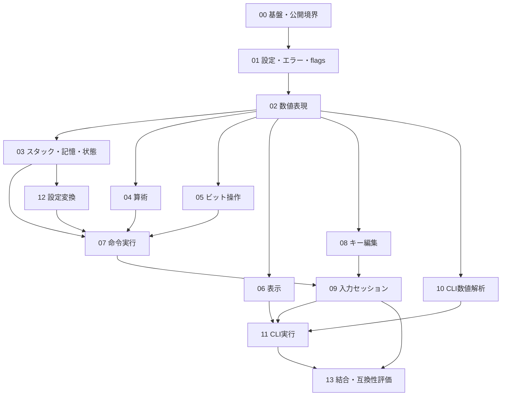

# 実装単位の詳細設計

実装単位の仕様書・詳細設計書をこのフォルダに格納する。D-1.0 / 2026-11-14（日本時間）。00～13の14本を作成済み。Core、HPキー入力、CLI数値解析・行実行は実装済み。端末の起動引数・REPL・ワンショット接続は後続作業。番号は文書の識別・配列用で、実装順序を表さない。

既存資料との対応、再点検で修正した内容、検証結果・未確定境界は[検証記録](review-and-validation.md)を参照する。

## 分割の方針

1ファイル・1関数ごとではなく、責務・入出力・受入条件をまとまりとして定義できる単位に分割する。1つの仕様書が複数のRustモジュールを扱ってよい。同じモジュールに関係する場合も、数値表現・純粋演算・状態反映など責務が異なれば別文書にする。

製品は既存設計どおり、次の3クレートを計画する。

| クレート | 責務 |
|---|---|
| `rdp-core` | 数値、演算、4段スタック、LAST X、flags、レジスタ、設定、StackLift、完成値の受入れ |
| `rdp-input` | HP形式のキー編集、EntryPhase・buffer・EntryPart、Coreと編集状態の協調更新 |
| `rdp-cli` | CLI構文、数値トークン解析、pending、REPL・一括実行、入出力・終了コード |

依存方向はCLI→Core、CLI→入力処理→Core。Coreには文字列編集や端末処理を持ち込まない。将来GUIは共通の入力処理を利用する。

## 仕様書一覧

各文書は責務、API・不変条件、処理規則、エラー、受入条件、関連TBDを定義する。

| ID・ファイル名 | 実装単位 | 主な規定内容 |
|---|---|---|
| [00](00-workspace-and-boundaries.md) | プロジェクト基盤・公開境界 | Workspace、3クレートの依存、公開型と内部型、試験配置、共通規約 |
| [01](01-config-errors-and-flags.md) | 設定・エラー・フラグの基礎 | 基数・数値モード・補数形式、設定検証、エラー型と依存を考慮した優先順位、FlagAction。個々の命令のフラグ条件は04/05に置く |
| [02](02-word-and-number.md) | 数値表現 | WordSize、raw bit、Number、値域、1補数の±0、有限f64、値検証と基本変換。全領域のモード切替は12に置く |
| [03](03-stack-registers-and-state.md) | 計算状態の保持 | 4段の基本操作、T複製、LAST Xの格納、RegisterBank、初期状態、StackLiftの格納、Snapshotと不変条件。命令ごとの更新は07に置く |
| [04](04-arithmetic.md) | 純粋な算術評価 | 整数四則・剰余・CHS・ABS・平方根、f64演算、評価結果とflags更新指示、境界・ゼロ除算。1補数は独立した判断・受入区分を設ける |
| [05](05-bitwise.md) | 純粋な論理・ビット評価 | 論理演算、シフト・回転、Carry、マスク・bit操作・bit数。引数式APIとHP命令の違いを明記する |
| [06](06-number-format.md) | 数値表示 | 基数別表現、符号・負0、F3・ゼロ埋め、f64表現。CLIの画面構成・出力先は11に置く |
| [07](07-calculator-and-commands.md) | Coreの命令実行 | Commandとmetadata、Push/Start/ReplaceX、ENTER等、STO/RCL、LAST X・flags・Liftの反映、execute/execute_all、単発の原子性、reset・照会。変換処理は12を参照する |
| [08](08-key-editor.md) | キー編集器 | 数字・点・指数・符号・BS、preview/finish、入力長、編集不変条件、Integer/Floatの編集規則。Coreとの一括確定は09に置く |
| [09](09-input-session.md) | キー入力と計算の協調 | HpInputSession、Key/Command振分け、旧設定でのfinish、編集終了・破棄・保持、全セッション原子性、InputSnapshot、エラーの包み分け |
| [10](10-cli-literals.md) | CLI数値解析 | 接頭辞・符号・文法、長整数の下位Wbit化、単独ハイフン、有限f64、LiteralError。HPキーの厳密入力と区別する |
| [11](11-cli-runtime.md) | CLIの構文と実行 | コマンド識別、keys、実行時設定での数値解析、CliSessionとpending、一括取消と先行成功保持、REPL/Batch、引数・入出力・終了コード |
| [12](12-configuration-transitions.md) | 設定変更と全領域変換 | 幅・補数・数値モード切替、スタック/LAST X/レジスタの変換、厳密変換失敗の全状態保持。独自設定APIとHP WSIZE/FLOATを区別する |
| [13](13-integration-and-compatibility.md) | 全体の受入・互換性評価 | 複数単位をまたぐシナリオ、既存TEST/SI/IAの対応、保留条件、暫定試験とHP互換試験の区別、到達範囲と非互換点 |

各単位のテストは各仕様書で定義し、13には単位をまたぐ受入条件をまとめる。単体テストの作成を最後まで延期しない。

矢印は主要な前提から利用側への関係。00のcrate依存図とは矢印の意味が異なる。08は編集規則だけを単独検証でき、Coreとの協調は09で検証する。13は受入条件を横断整理する文書で、検証は各段階から実施する。

## 実装・仕様具体化の順序

全体設計第12章の段階を、上記の文書へ対応させる。1冊を完全に実装してから次へ進む必要はなく、Integerの基本経路を先に通し、その後に命令・Float・設定変換を拡張する。

| 順序 | 対応文書 | 作業・到達点 |
|---|---|---|
| 1 | 00 | Workspace・責務境界・試験配置を具体化する |
| 2 | 01・02 | 安全な型、数値表現、エラー、flagsの基盤を実装する |
| 3 | 03 | スタック・記憶・初期状態・Snapshotを実装する |
| 4 | 04のUnsigned/2補数 | 基本整数算術を状態変更なしで検証する |
| 5 | 06・08の基本整数編集・10 | 表示、キー編集、CLI数値解析をそれぞれ単独で検証する |
| 6 | 07→09 | Coreの命令実行を成立させ、その後にキー編集と統合する |
| 7 | 04の1補数・05、07/09の対応部分 | 該当TBDを判断し、論理・ビット操作などを命令経路へ接続する |
| 8 | 11 | 数値解析・命令・セッションをCLIへ接続し、基本整数CLIを成立させる |
| 9 | 12、04/06/08のFloat、07/09/10/11の関連部分 | Float・設定変更を単体から統合へ進める |
| 10 | 13 | 実装済み経路の受入・資料照合・互換性評価をまとめる。試験自体は各段階でも実施する |

将来のレジスタ演算・Iレジスタ・間接指定・倍長演算・LJ等の追加仕様、GUI固有仕様は、対象範囲の判断後に別文書として追加する。現在のAPIで実機命令を代用しない。HP内蔵プログラミングは既存方針どおり対象外。

## 各仕様書の共通項目

各文書には次を記載し、その単位を実装・レビューできる状態にする。

1. 目的、対象範囲、扱わない責務、参照資料
2. 対象クレート・モジュール、依存する単位、公開境界
3. データ型、不変条件、所有関係
4. API、引数・戻り値、事前条件・事後条件
5. 処理規則・アルゴリズム・状態遷移
6. エラー条件・優先順位・失敗時に保持する状態
7. 境界値、受入条件、既存TEST/SI/IA IDとの対応
8. 関連TBD、確定部分・暫定採用部分・保留部分、判断が必要になる時点

状態を変更しない単位では状態遷移の代わりに入出力と副作用の有無を明示する。未実装の依存機能や保留試験があれば、完了条件への影響も記載する。

## 既存資料との関係

- [全体詳細設計 v0.6](../rdp-calc-detailed-design.md)：全体構成、演算契約、実装順序の基準。
- [入力API設計 IA-1.0](../rdp-calc-input-api-design.md)：入力の所有・API、CLI変換、エラー順位の正本。旧記述より優先する。
- [スタック・入力詳細設計 SI-1.1](../rdp-calc-stack-input-detailed-design.md)：キー状態遷移の基準。
- [試験仕様](../rdp-calc-stack-input-test-cases.md)：既存ID・期待値・移設方針を引き継ぐ。
- [未確定事項一覧](../rdp-calc-tbd-list.md)：TBDの管理表。各単位では該当IDと局所的な実装判断を参照する。
- [設計判断記録](../rdp-calc-design-decisions.md)、[マニュアル照合記録](../rdp-calc-manual-review.md)：決定の経緯と根拠を参照する。

既存資料は `documents/` に維持する。実装単位への具体化によって既存の確定契約を暗黙に変更しない。契約を変更する場合は、関連する既存正本・TBD・判断記録・試験仕様も同期する。
