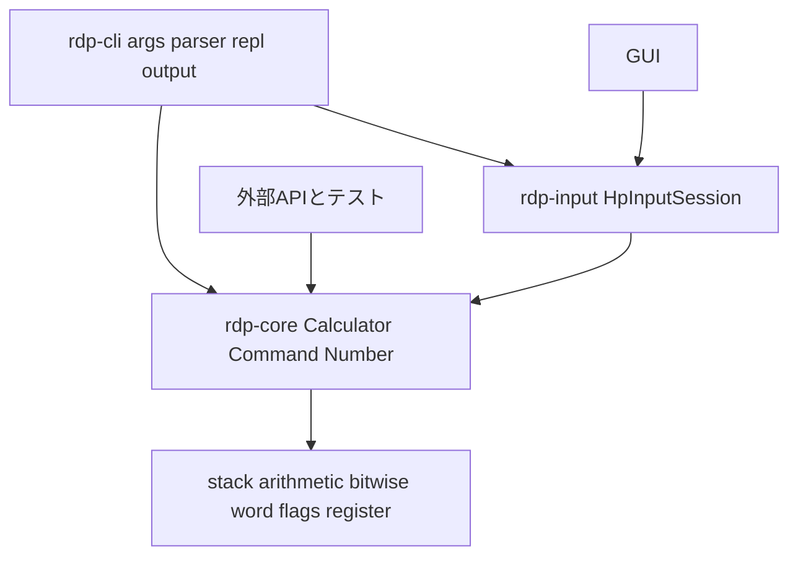
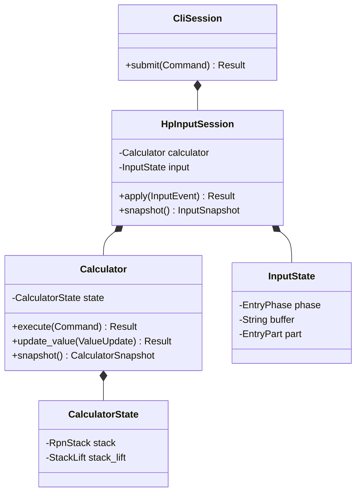
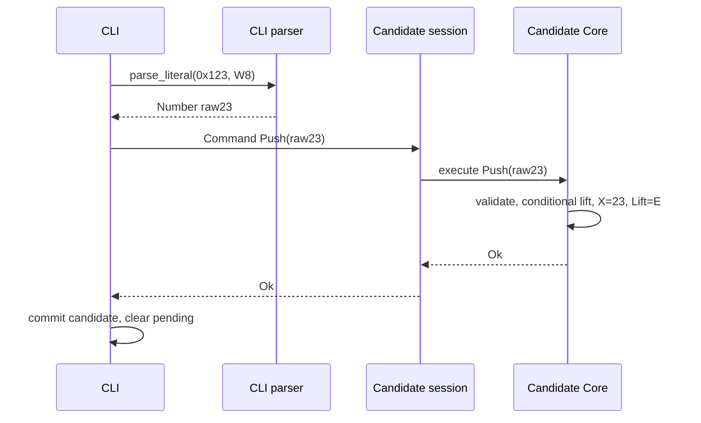
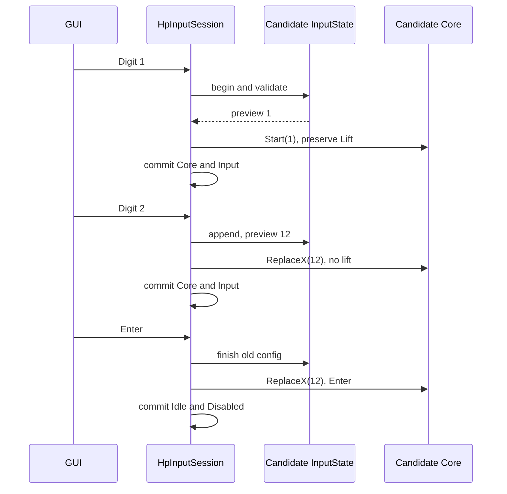
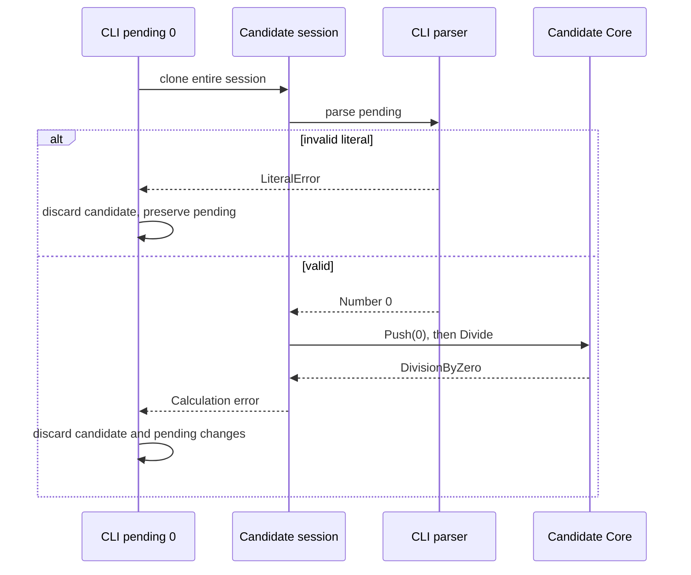

# rdp-calc 入力API詳細設計

IA-1.0 / 2026-10-31（日本時間） / 設計確定・未実装

基準：develop `eecb806`（PR #1・#2マージ済み）。ソースはHello worldのみ。以下は設計APIの改訂であり製品コードは変更しない。本書は入力所有・API・CLI解析・エラー優先順位の正本。[詳細設計](rdp-calc-detailed-design.md)の演算式・flags・独自設定変換は維持し、入力に関する旧記述は本書で置換する。[SI設計](rdp-calc-stack-input-detailed-design.md)と[試験仕様](rdp-calc-stack-input-test-cases.md)を併読する。

## 1. 比較と採用構成

| 観点 | A：Coreに編集を維持 | B：各UIへ完全外部化 | C：共通アダプター分離（採用） |
|---|---|---|---|
| HP互換 | 既存遷移を直接維持 | UIごとに差が生じやすい | 共通部品で遷移を維持 |
| 依存 | Coreが文字編集を知る | Coreは値のみ | Coreは値のみ、アダプター→Core |
| 状態管理 | 単一state | UIごとに協調処理 | 所有セッションで協調処理 |
| CLI容易性 | 不要な編集ガードが残る | 最も容易 | 通常はPush、keysだけ共通編集 |
| GUI展開 | Coreの変更を招く | 再実装が必要 | 部品を再利用 |
| 単体試験 | 計算と編集が混在 | UI編集試験が重複 | CLI・Core・キーを分離 |
| 変更規模 | 小 | 中～大 | 中、編集移設と数値更新API |
| 原子性 | state clone | UIごとに保証 | Core＋編集の候補コピー |

Cを採用する。StackLiftをCoreの計算状態として残し、編集を一か所に集約できるため。trait分割、イベントバスは不要。`rdp-input`を将来workspaceへ追加し、CLIパーサーは`rdp-cli`内に置く。Cargoの変更は今回行わない。



Coreは端末・入出力・CLI・文字列編集に依存しない。GUIもCLIを経由しない。Coreのformat_numberは数値表示関数として維持し、parse_number/preview_numberはCLIとキー編集器それぞれの規則へ分離する。

## 2. CP-01・CP-02：CLI変換（Resolved）

前後ASCII空白を除いた1トークン、256バイト以内（符号・接頭辞込み）。整数文法は任意の先頭符号、任意の0b/0o/0d/0x（大小文字可）、1桁以上の基数に適合する数字。空・内部空白・underscore・全角・桁なし接頭辞を拒否する。基数省略は実行時設定、接頭辞は表示基数を変更しない。Floatは既存の有限f64十進文法を維持し整数マスクを適用しない。

単独`-`は全モードで正0へ変換する。CLIトークン識別でもLiteralとし、従来の減算エイリアス`-`を廃止、減算には`sub`を使用する。`keys "... -"`の減算キーにはCP-02を適用しない。単独`+`は従来の加算命令、数値パーサー単体ではInvalidNumber。`-1`等は通常の負数。

W=1..64、M=2^W-1。絶対値をu128で逐次 `a=(a*base+digit)&M` と蓄積する。各段階でaは64bit以内、base≤16なので中間積も安全。全桁をi128等へparseしてからマスクしない。W64でu64の1<<64を使用しない。

| 表記 | raw |
|---|---|
| 非負、全SignedMode | a |
| 負、TwosComplementまたはUnsigned | (2^W-a)&M |
| 負、OnesComplement | M xor a |

1補数は数学値そのもののmodではなく、無限幅の絶対値のビット反転後に下位Wbitを採用する。範囲内の-1→FE、-123→84（W8）と既存解釈を保つ。Unsigned負数も剰余で受理する製品判断であり、結果表示は非負。範囲外では入力符号と表示符号が異なることがある。

W8のHEX期待値：0x12→12、0x123→23、0x1FF→FF、0x100→00。DECの-123はTwos/Unsignedで85、Onesで84。初期基数HEXの`-123`とは異なるので、基数に依存させない場合は`-0d123`を使う。`0d-123`は不正。

明示`-0`はOnesでM、Twos/Unsignedで0、Floatで-0.0。単独`-`は常に正0。Onesの無符号表記0xFFも負0として解釈する。入力はC/Gを変更しない。

CoreのPushは幅外・非有限・mode違いを拒否し、自動切り捨てしない。Word::from_bitsの明示マスクは維持するが、それで失われた上位bitをCoreが検出することはできない。幅16で作ったraw123をW8へPushすればIntegerOutOfRange。HPキーは現行の厳密範囲拒否を暫定維持しCP-01を適用しない（TBD-013）。

## 3. API・所有・内部処理

Rust宣言は設計スケッチで関数本体を省略する。Number/Word/設定/flagsの型は既存どおり。

```rust
// rdp-core
#[derive(Clone)]
pub struct Calculator { state: CalculatorState, initial_config: CalculatorConfig }
pub(crate) struct CalculatorState {
    stack: RpnStack, registers: RegisterBank, flags: Flags,
    word_config: WordConfig, radix: Radix, numeric_mode: NumericMode,
    stack_lift: StackLift,
}
pub struct CalculatorSnapshot {
    pub stack: [Number; 4], pub last_x: Number, pub registers: Vec<Number>,
    pub flags: Flags, pub word_config: WordConfig, pub radix: Radix,
    pub numeric_mode: NumericMode, pub stack_lift: StackLift,
}
pub enum ValueUpdate { Start(Number), ReplaceX(Number) }
impl Calculator {
    pub fn new() -> Self;
    pub fn with_config(config: CalculatorConfig) -> Result<Self, CalcError>;
    pub fn execute(&mut self, command: Command) -> Result<(), CalcError>;
    pub fn execute_all(&mut self, commands: impl IntoIterator<Item = Command>)
        -> Result<(), CalcError>;
    pub fn update_value(&mut self, update: ValueUpdate) -> Result<(), CalcError>;
    pub fn snapshot(&self) -> CalculatorSnapshot;
    pub fn test_bit(&self, index: u8) -> Result<bool, CalcError>;
    pub fn reset(&mut self);
}
// private
fn validate_value(value: Number, state: &CalculatorState) -> Result<(), CalcError>;
fn apply_command(state: &mut CalculatorState, cmd: Command) -> Result<(), CalcError>;
fn apply_value(state: &mut CalculatorState, update: ValueUpdate) -> Result<(), CalcError>;
```

主入力APIはCommand::Push(Number)：旧Liftに応じて条件lift→X=n→Enabled。Startは同じ条件lift→X=nだがLiftを保持、ReplaceXはXのみ置換しLift保持。両者はLAST X/flags保持、Pushと同じ厳密値検査と原子性。ReplaceXは編集状態を要求しない明示的数値置換APIである。Liftの公開setterは追加しない。

CommandからInputDigit/InputDecimalPoint/InputExponent/Backspaceを除去、その他全variantは詳細設計§3.4を維持する。CommandMetadataからterminates_entryとphase引数を除去、lift_effect/last_x_effectを維持。Enterは常にlift後Disabled、ClearXは+0/Disabled、ChangeSignは確定Xへの演算（Integer SaveX、Float KeepL、どちらもEnabled）。

```rust
// rdp-input。Cloneは全所有値の独立コピー
#[derive(Clone)]
pub struct HpInputSession { calculator: Calculator, input: InputState }
#[derive(Clone)]
struct InputState { phase: EntryPhase, buffer: String, part: EntryPart }
pub enum EntryPhase { Idle, Editing }
pub enum EntryPart { Mantissa, Exponent }
pub enum Key { Digit(char), DecimalPoint, Exponent, Backspace, ChangeSign }
pub enum InputEvent { Key(Key), Command(Command) }
pub struct InputSnapshot {
    pub calculator: CalculatorSnapshot,
    pub entry_phase: EntryPhase, pub input_buffer: Option<String>,
    pub entry_part: EntryPart,
}
pub enum InputError {
    InvalidDigit { digit: char, radix: Radix }, InvalidNumber,
    IncompleteEntry, InputInProgress, InputTooLong, InvariantViolation,
}
pub enum SessionError { Input(InputError), Calculation(CalcError) }
impl HpInputSession {
    pub fn new(calculator: Calculator) -> Self; // Idle、既存Core値/Lift保持
    pub fn apply(&mut self, event: InputEvent) -> Result<(), SessionError>;
    pub fn snapshot(&self) -> InputSnapshot;
    pub fn test_bit(&self, index: u8) -> Result<bool, SessionError>;
    pub fn reset(&mut self); // Core resetと編集破棄を同時に行う
}
fn edit(input: &mut InputState, key: Key, config: &CalculatorSnapshot)
    -> Result<Number, SessionError>;
fn finish(input: &mut InputState, config: &CalculatorSnapshot)
    -> Result<Number, SessionError>;
fn apply_candidate(session: &mut HpInputSession, event: InputEvent)
    -> Result<(), SessionError>;
```

Coreは数値プレビューXを保持するが、未完成指数や文字列を知らない。セッションの不変条件はEditingでX==preview(buffer)、Idleでbuffer空/part=Mantissa。GUIはInputSnapshotを読む。Coreのmutable getter・restore APIは公開しない。

数字は候補buffer検証後、初回Start・継続ReplaceX。Float編集中CHSはedit＋ReplaceX、Integer CHSとIdle Float CHSはfinish後Core ChangeSign。InputEvent::Command(ChangeSign)も同じ分岐へ統一。BSはEditingならedit＋ReplaceX、IdleならClearX。CLx/ClearStackはfinishなしで編集破棄。ClearRegisters/snapshotは編集保持。それ以外のSI終了命令は旧設定でfinish＋ReplaceX（再liftなし）後Coreへ渡す。Editing中Push/test_bitはInputInProgress。

```rust
// rdp-cli
pub(crate) struct ParseContext {
    radix: Radix, mode: NumericMode, word_config: WordConfig,
}
pub(crate) enum LiteralError {
    InputTooLong, InvalidDigit { digit: char, radix: Radix },
    InvalidNumber, FloatingPointOutOfRange,
}
pub(crate) fn parse_literal(text: &str, context: ParseContext)
    -> Result<Number, LiteralError>;
pub(crate) enum CliRuntimeError {
    Syntax(CliError), Literal(LiteralError), Input(InputError),
    Calculation(CalcError), Io(std::io::Error),
}
pub(crate) struct CliSession { hp: HpInputSession, pending: Option<String> }
impl CliSession {
    pub(crate) fn submit(&mut self, next: Option<Command>)
        -> Result<(), CliRuntimeError>;
}
```

CLI通常Literalは実行時設定でparse→InputEvent::Command(Push)、keysはInputEvent列。キー編集中とCLI pendingの同時保持を禁止し切替はInputInProgress。直接Core利用者はアダプター不要。



## 4. CP-03：優先順位と原子性（Resolved）

既存CalcErrorは詳細設計§3.5の設計定義を調査した。入力固有5種をInputErrorへ移し、CoreへInvariantViolationを追加する。InvalidConfigurationは利用者の設定不正であり内部破損と区別する。改訂後の全Core variantと優先順位は次表。同順位は左から、同variantの複数対象はX,Y,Z,T,L,R0..Rnの順。

```rust
pub enum CalcError {
    InvariantViolation, AllocationFailed,
    DivisionByZero, DomainError,
    IntegerOutOfRange, FloatingPointOutOfRange,
    InvalidWordSize(u8), InvalidRegisterCount(usize), InvalidRegister(usize),
    InvalidFlag(u8), InvalidBitIndex(u8), InvalidCount, InvalidConfiguration,
    NumericModeMismatch, UnsupportedOperation,
}
```

| 順位 | CalcError | 意味 |
|---|---|---|
| 0 | InvariantViolation | 実stateまたは候補の不変条件違反 |
| 1 | AllocationFailed | 回復可能な確保失敗 |
| 2 | DivisionByZero, DomainError | 定義されない計算条件 |
| 3 | IntegerOutOfRange, FloatingPointOutOfRange | 幅外、非有限、厳密変換不能 |
| 4 | InvalidWordSize, InvalidRegisterCount, InvalidRegister, InvalidFlag, InvalidBitIndex, InvalidCount, InvalidConfiguration | 構造引数・設定不正 |
| 5 | NumericModeMismatch, UnsupportedOperation | 型・命令不適合 |

Integer→Floatの有限だが精度欠落する変換、Float→Integerの非整数/範囲外はIntegerOutOfRange。NaN/Inf/非有限結果はFloatingPointOutOfRange。整数overflowは既存の成功＋flagsでありエラーではない。

順位は**前提を満たして安全に判定可能な条件同士**に適用する。下位エラーを検査の都合で先に発見しても、独立な上位条件を検査してから最初の順位を返す。前提不成立の演算を試して潜在エラーを発生させない。

1. 実stateの全不変条件を読取検査。不正ならInvariantViolation。無効幅のシフトや無効index参照を行わない。
2. 引数構造、Number有限性/幅、mode適合を独立検査。indexは参照前、幅はmask前に検証。Integer modeでPush(Float(NaN))はFloatingPointOutOfRangeがmode不一致に優先。
3. 前提が揃う演算のみゼロ/domain検査。DIV/RMDは両符号ゼロを拒否して実除算しない。前提欠落の下流エラーは候補に含めない。
4. エラーなしの場合のみ純粋評価・全領域厳密変換。書換え前に候補エラーの順位と対象順を確定。
5. 候補に移動・LAST X・flags・Liftを反映し不変条件検査、成功時のみ実stateと置換。候補不整合はInvariantViolation。

アダプターは内部不整合→回復可能確保→独立に判定できるCore条件→InputTooLong→InputInProgress→InvalidDigit/InvalidNumber/IncompleteEntryの順。キーのmode不一致はCalculationへ包む。Float `1e`＋SetRadix(HEX)は入力と独立に判定可能なCalculation(NumericModeMismatch)。`1e`＋DivideはInput(IncompleteEntry)でありpreviewを除数にしない。重複点はInput(InvalidNumber)。同じ文字不正は左端を返す。

CLIは長さ→符号/接頭辞/桁存在→左端不正桁→有限Float変換。空、内部空白、符号重複、符号位置不正、桁なしはInvalidNumber。整数の数字列中のunderscore・全角・基数外文字はInvalidDigit。Floatの文法不一致（NaN/Inf/接頭辞/未完成指数を含む）はInvalidNumber。長さ超過＋不正桁はLiteral(InputTooLong)。解析失敗ではCoreを呼ばずCoreとの潜在エラー競争をしない。

HpInputSession::applyはCoreとInputStateを一緒にcloneし成功時のみ全体置換。CLI submitはpendingも含め候補化しparse→Push→nextを一括実行、全成功時だけpendingを消す。失敗では全数値/L/flags/設定/編集/part/Lift/記憶領域を保持する。OSのOOM abortは従来どおり保証外。

通常REPL/Batchの空白区切りトークンは個別確定。`5 0 /`はPush成功分を保持して除算だけ失敗。対してpending=`0`からsubmit(Some(Divide))はPushも巻き戻しpendingも残す。Core::execute_allは従来どおり逐次・先行成功保持であり一括ロールバックの代用ではない。行全体の構文不正は実行前に拒否、数値内容は実行時解析のため先行成功を保持。

終了コード：Syntax/Literal→2、Input/Calculation→1、Io→3。CLI数値拒否は従来の計算エラー1から2へ移る。キーエラーは1を維持する。

## 5. 操作例とシーケンス

各例独立、特記なければW8/DEC/Twos、[X,Y,Z,T]=[5,2,3,4],L=9,Lift=E、flags保持。

| # | 操作 | 結果・処理 |
|---|---|---|
| 1 | CLI 0x123 | raw23→Push、[35,5,2,3],L9,E |
| 2 | CLI - | 正0→Push、[0,5,2,3],L9,E |
| 3 | CLI -123 | raw85、[-123,5,2,3],L9,E。Ones raw84、Unsigned数学値133 |
| 4 | CLI enter | [5,5,2,3],L9,D。続く完成値3で[3,5,2,3],E |
| 5 | CLI 0x1G | Literal(InvalidDigit)、Core/pendingとも不変 |
| 6 | X0,Y5でDivide | DivisionByZero、全状態不変 |
| 7 | IntegerでPush(Float(NaN)) | 非有限とmode不一致→FloatingPointOutOfRange、不変 |
| 8 | GUI digit1,digit2 | Start→ReplaceX、[12,5,2,3],L9,E、Editing(12)、liftは一度 |
| 9 | Float GUI 12→CHS→BS | [-1,5,2,3],L9,E、Editing(-1)。次のBSはTBD-021で期待値未確定 |
| 10 | pending=0＋Divide | 候補Pushと除算を取消、実Coreは[5,2,3,4],L9,E、pending=0保持 |







## 6. 変更範囲・残件

CLI互換変更は範囲超過/Unsigned負数受理、単独-の0化（減算sub）、Literal終了コード。API変更は編集型・キー命令の移設、数値更新API、snapshot分離。算術・HPスタック効果は維持する。CoreはEditingを知らないためSI-18のPush拒否はセッションの契約となる。

TBD-013のCLI部分はResolved、HP部分はPartial。TBD-021はFloat BSの製品・HP境界としてOpenを維持しCP-02と混同しない。TBD-022はResolved。その他HP変換・flags・記憶領域・表示解除の残件は維持する。マニュアル照合記録は既存調査として継承し今回新たな実機確認を主張しない。

レビュー重点は1補数ビット列化、単独-の移行、ValueUpdateの公開範囲、候補コピーコスト、順位の依存ガード。CP-01～03は製品設計として確定し、これらのレビュー項目を未確定仕様と混同しない。
