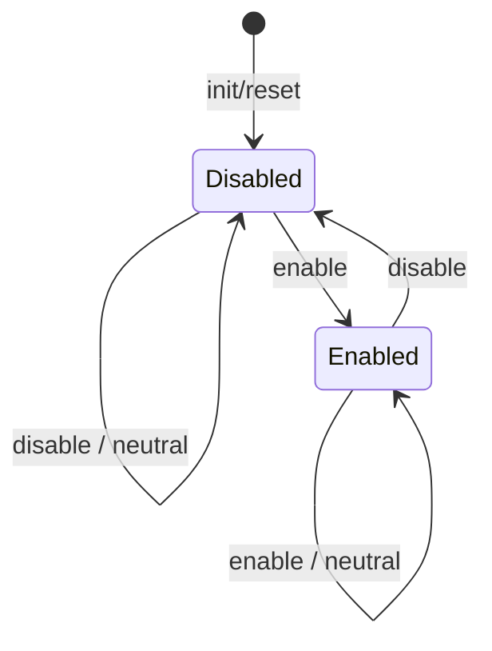
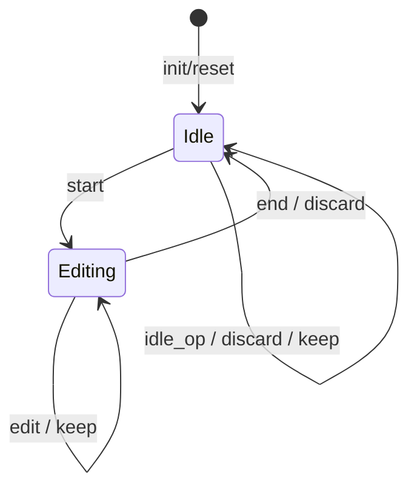

# rdp-calc RPNスタック・数値入力 詳細設計

2026-11-21 製品仕様（TBD-021 / DD-049）：Float編集でBS後に仮数の符号だけが残る場合、bufferを `0`、Xを `+0.0` とし、Editing / MantissaのままLiftを保持する。次の数字は追記する。IA-G012（旧SI-H003）を製品受入試験に含める。HP実機との照合はTBD-017で継続する。 TBD-001・006・008・016・018・019の製品判断を含む現在の集計はResolved 13 / Partial 9 / Open 0。以下の旧集計・保留記述は決定前の記録。

版：SI-1.1（入力API分離反映） / 2026-10-31（日本時間） / UTF-8・LF

現行入力APIは[入力API設計 IA-1.0](rdp-calc-input-api-design.md)を優先する。以下のv0.5/HP照合は過去の根拠を維持する。状態表はCore単体ではなくHpInputSession全体に適用する。

旧照合基準：`develop` の `25bb2dea3fcb3162868e22cca5b5334c8375f4d6`（PR #1マージ後）。[基準設計v0.5](https://github.com/koba-nobu-8287/rpn-calculator/blob/25bb2dea3fcb3162868e22cca5b5334c8375f4d6/documents/rdp-calc-detailed-design.md)を当時の正本として照合した。今回の入力API・CP-01～03はIA-1.0で改訂し、それ以外の確定契約は維持する。HP未確認の提案を確定仕様へ昇格させない。

関連：[テスト仕様](rdp-calc-stack-input-test-cases.md)、[TBD管理表](rdp-calc-tbd-list.md)、[判断記録](rdp-calc-design-decisions.md)、[詳細設計v0.6](rdp-calc-detailed-design.md)、[過去の照合記録](rdp-calc-manual-review.md)。リポジトリでは全ファイルを既存の`documents/`に配置する。

## 1. 適用範囲と根拠の強さ

- **継承**：v0.5の製品契約。暫定と記載された契約は暫定のまま。
- **確認**：今回取得できたHP著マニュアル本文に明記された事項。
- **導出**：確認済み規則の合成による期待値。実機観測ではない。
- **提案**：契約変更または未定義部分の補足。レビュー待ち。
- **未確認**：根拠不足。HP互換試験を合格扱いにしない。

プログラミング機能は対象外、外部自動化はCLI、Floatは有限`f64`を維持する。GUI固有のキー接頭辞・エラー画面・表示窓はコア状態に混ぜない。数値フラグの全演算仕様はv0.5 §7を参照する。

### 1.1 調査資料とアクセス上の限界

| ID | 資料・節 | 今回の確認方法 |
|---|---|---|
| V5 | developの4文書と`src/main.rs`、`Cargo.toml` | GitHub連携から取得。ソースはHello worldのみ、実装済みテストなし。workspace構成は計画であり現状ではない |
| H22 | [HP原版 Section 2 / 印刷p.22](https://www.manualslib.com/manual/3355600/Hp-Hp-16c.html?page=24) | HP著本文の転載。ENTER、Drop、T複製 |
| H25 | [HP原版 Section 2 / 印刷p.25](https://www.manualslib.com/manual/3355600/Hp-Hp-16c.html?page=27) | ENTER/CLxの次回入力抑止。V5照合記録とも比較 |
| H32 | [HP原版 Section 3 / 印刷p.32](https://www.manualslib.com/manual/3355600/Hp-Hp-16c.html?page=34) | 幅変更、符号bitへの入力、W≤3の初回桁例外の本文 |
| H99 | [HP原版 Appendix B / 印刷p.99](https://www.manualslib.com/manual/3355600/Hp-Hp-16c.html?page=101) | 入力終了とLift分類。キー記号の一部はOCR欠落、欠落部分だけで新規確定しない |
| CE | [HP 16c Collector’s Edition Owner’s Handbook, Edition 2, November 2025](https://literature.hpcalc.org/official/hp16c-ce-oh-en.pdf) | 検索可能本文。§1 p.17–19、§5 p.56–60、Appendix B p.99–100を読んでV5との一致を確認。取得版のp.99はPDFの103ページ（0始まり102） |
| V5-H | V5のSRC-08/09とマニュアル照合記録 | 原版p.23–25、44、67、98、100等の過去の画像確認記録を継承。今回はその原画像の再確認とは呼ばない |

元の添付PDF・v0.1～v0.3はこのチャット／作業領域には存在せず、リポジトリにも含まれない。過去資料についてはV5の引用・変更履歴を参照した。原版PDFの全文取得とCEの画像取得は利用経路で失敗したため、取得できた本文とV5の過去照合を区別する。別機種の仕様を根拠にしていない。CEのキー記号文字化けや版によるPDFページ差を避け、以下は原則として**印刷ページ**を示す。

### 1.2 差異と優先順位

| 差異 | 扱い |
|---|---|
| v0.1～v0.3のCHS、幅拡大、LAST Xに関する旧記述 | V5のDD-026/027/030を優先。原文を今回再取得したとはしない |
| V5の配置計画は`docs/`、実際は`documents/` | 実在する`documents/`へ合わせる。モジュール計画は変更しない |
| 計画edition 2021、現Cargo.tomlは2024 | 文書と実装雛形の差として記録。今回Cargoを変更しない |
| CE/原版とV5独自APIの差 | §3の照合表と§9の変更提案へ分離。developを自動修正しない |
| 今回参照したCEのページ位置 | PDF 1始まり番号は印刷番号+4。過去の原版添付の+2を他PDFへ流用しない |

## 2. 状態モデルと不変条件

**入力とLift許可を直交する2状態機械として維持し、HpInputSessionがCoreと編集を1トランザクションで協調更新する。** `EntryPhase::{Idle,Editing}`と`StackLift::{Disabled,Enabled}`を維持する。4つの組合せはすべて到達可能であり、新しい4値enumは導入しない。Floatの仮数／指数は`EntryPart`、整数／Floatは`NumericMode`に分離する。方式の変更ではなくDD-003の具体化である。

| 状態名 | 意味・不変条件 | 受理イベント／出口 |
|---|---|---|
| I_D | Idle、Lift Disabled。buffer空、part=Mantissa。次の数値開始はX上書き | 数字開始→E_D、ENTER/CLx→I_D、演算成功→I_E |
| I_E | Idle、Lift Enabled。buffer空、part=Mantissa。次の数値開始は一度Lift | 数字開始→E_E、ENTER/CLx→I_D、演算成功→I_E |
| E_D | Editing、Lift Disabled。buffer非空、Xはプレビュー | 編集→E_D、ENTER/CLx→I_D、中立終了→I_D、演算成功→I_E |
| E_E | Editing、Lift Enabled。buffer非空、Xはプレビュー。追加桁ではLiftしない | 編集→E_E、ENTER/CLx→I_D、中立終了→I_E、演算成功→I_E |

上表の代表イベントの全ガード・失敗は§5が正本。Dは「次回の新規入力を上書き」、Eは「次回の新規入力をLift」と読む。**Eに設定するだけでは値は一切移動しない。DでもENTER自身は値を移動する。** 編集中には現在のE/Dを参照した自動Liftを行わない。E/Dを「直前に持ち上げたか」という履歴フラグに読み替えない。

全状態の不変条件：4段が常在し空スタックなし、順序は`[X,Y,Z,T]`。全数値とLAST X・記憶領域はmodeに一致、整数は幅内、Floatは有限。flagsの上位2bitは0。EditingではASCII buffer長1～256、modeに合った編集文法、`X == preview(buffer)`（Floatの比較は必要時bit単位）。指数未完成は許容するがコミット用の数値解析では拒否する。IdleのXは確定値である。記憶領域長は固定。

`begin()`直後の空bufferは候補状態内だけの一時状態で、snapshotや成功後のstateへ公開しない。不変条件の検証はコマンド成功直前に行う。

### 2.1 バッファとXの所有関係

V5の分離を維持：**編集中の正本は文字列、Xは数値プレビュー**。編集開始前の確定Xを別フィールドに恒久保存しない。自動Liftが必要なら、その旧XをYへ退避してから初回プレビューをXへ書く。CLxは編集開始前のXを復元しない。

`finish_entry`は旧mode／旧radix／旧WordConfigで完成値を再解析し、Xへ採用、buffer空、Idle、part=Mantissaにする。Lift・LAST X・flagsを変えない。後続の演算や設定変更で失敗すれば、この入力確定も候補ごと破棄する。

例：Floatの`1e-`ではX=1.0のプレビューだが、ENTERはIncompleteEntryで失敗する。snapshotのXだけを見て「1が確定済み」と判断してはならない。公開InputSnapshotの`input_buffer`と`entry_phase`も参照する。内部で解析済み値を一時保持することは可能だが、二重の永続的正本は作らない。

## 3. マニュアルとの操作別照合

「一致」は記載範囲についての設計一致であり実装試験合格ではない。

| 操作 | マニュアルの動作 | V5の契約 | 判定・必要な変更 | 根拠 |
|---|---|---|---|---|
| ENTER | 自身はLiftしXをYへ複製、次の入力／RecallはX上書き | 常にlift後D、入力終了 | 一致。繰返しにも同じ式を適用 | H22/H25、H99 |
| CLx | Xを0、次回Lift無効 | buffer破棄、X=0、I_D | 一致。入力確定を要求しない | H25、CE §1 p.17、H99 |
| CHS Integer | 補数演算、入力終了、X履歴保存 | finish、SaveX、E | 一致（V5-H継承）。境界flagsは007/008 | V5-H p.44/99/100、CE Appendix B p.99–100 |
| CHS Float | 編集を終了せず仮数／指数の符号を操作、LAST X保存対象外 | Editingは編集継続・Lift保持、IdleはE | 分類一致。Idle Eは一般分類から導出。符号だけ残るBS境界は未確認 | CE §5 p.58、Appendix B p.100、V5-H |
| R↓/R↑/X<>Y | 循環／交換、入力終了、Lift有効、LAST X保持 | 同左 | 一致（過去照合継承） | V5-H §2 p.23、Appendix B p.99–100 |
| 二項演算 | Y op XをXへ、Drop、T複製 | 同左、成功後E、SaveX | 一致。すべての命令を二項と一括分類しない | H22、V5-H p.24/100 |
| 単項演算 | 通常は他段を動かさずXを置換 | 同左、成功後E | 一致。Float CHSのLAST X例外を保持 | H22、V5-H p.100 |
| LAST X | 対象計算前Xを記録、Recallは現在Liftに従う | Save/Keep/Clearを命令別指定 | 一致。入力編集・失敗では保存しない | V5-H §2 p.23–25、Appendix B p.100 |
| STO/RCL | STOはX複製、RCLは次の数値取込み、実行後E | finish、STO無移動／RCL条件Lift、L保持 | 基本動作一致、物理記憶配置は不一致 | V5-H p.25/66/67/99/100、TBD-011 |
| 整数HEX/DEC/OCT/BIN | 入力終了、Lift中立、同じraw値の別表示 | 旧基数finish後変更、Lift保持 | 一致。基数変更後の数字は続きではない | H99、CE Appendix B p.100、V5-H |
| WordSize | HP WSIZEはXを引数にDrop、元X保存、領域を再配置 | SetWordSize引数指定、無Drop・履歴保存なし、全値マスク／ゼロ拡張 | 意図したAPI差。HP版追加を提案、004/014継続 | H32、V5-H p.67/100 |
| モード変更 | HP FLOATはY×2^X、Y/Z/T/Lを消去。Floatから基数キーで整数へ | SetNumericModeは全値厳密変換、SetRadixはFloat→整数にしない | 不一致を明示した独自契約。勝手に置換しない | CE §5 p.56–60、V5-H p.57、006 |
| BS | 編集中は最後の桁削除、終了後はCLx | ASCII末尾1字を削除、空なら0、IdleはCLx | 一般分類一致、符号／指数削除の細部は未確認。021提案 | CE §1 p.17–18、H99 |
| 初回桁が幅外 | W≤3で基数上有効だが幅を超す初回桁は0になる | IntegerOutOfRange、全状態保持 | **新規確認した差異**。013をPartialへ。互換変更はTBD-013に残す。CP-01はCLIだけ確定 | H32脚注 |
| 正整数の符号bit到達 | 入力が符号bitに達すると負の表示になり得る | DEC数学値／他基数rawの解析区別 | キー入力でのDEC範囲扱いは不一致の可能性。CLIとの分離をレビュー | H32脚注、V5 §4.12、013 |
| 不正桁／桁数上限 | 全基数・全境界のキー応答は今回確定できず | 不正数字Err、256文字上限、値範囲外Err | 製品契約を維持、HP互換とは認定しない | V5 §6.4、013/017 |
| エラー | 任意キーでエラー表示解除（過去CE確認） | コアはErr、全state保持、次のCommandは通常実行 | 表示解除とコア原子性を分離、キー消費は未確認 | V5照合記録、CE Appendix A p.96、012 |

## 4. スタックの値変換と命令効果

以下は操作直前（入力終了後）の値を`x,y,z,t,l`と書く。全て同時代入であり、左から順に上書きして参照値を壊さない。

| プリミティブ／操作 | 実際の[X,Y,Z,T] | LAST X | Lift制御 |
|---|---|---|---|
| lift() | [x,x,y,z]、旧t喪失 | 保持 | プリミティブ自身は触らない |
| drop_stack() | [y,z,t,t] | 保持 | 同上 |
| ENTER | [x,x,y,z] | l | D |
| CLx / Idle BS | [0,y,z,t] | l | D |
| R↓ | [y,z,t,x] | l | E |
| R↑ | [t,x,y,z] | l | E |
| X<>Y | [y,x,z,t] | l | E |
| 二項op成功 | [op(y,x),z,t,t] | x | E |
| 単項op成功 | [op(x),y,z,t] | 通常x、Float CHSはl | E |
| 新規キー入力n | Eなら[n,x,y,z]、Dなら[n,y,z,t] | l | 元のE/D保持 |
| Editing中の編集n | [n,y,z,t] | l | 保持 |
| STO i | [x,y,z,t]、Ri=x | l | E |
| RCL i / LAST X | Eなら[v,x,y,z]、Dなら[v,y,z,t] | l | E |
| Push(n)、Idle限定 | RCLと同じ値変換、v=n | l | E |

RecallLastXは**移動前にv=lをコピー**する。二項演算は元Xを保存してからdropし結果を置く。Tを減らしたり0にしたりしない。R↓/R↑は循環であってLift/Dropではない。Stackの低水準関数は`InputState`もflagsも知らない。

LAST Xの全分類はV5 §5.2.1を維持する。算術・論理・シフト・回転・CountBitsはSaveX、Float CHSはKeep。ENTER/CLx/BS/Swap/Roll/STO/RCL/LAST X/入力/基数変更はKeep。独自ClearStackはClear。独自SetWordSize/SetNumericModeは値表現の変換のみで「新しい履歴保存」ではない。HP WSIZEのSave、HP FLOATのClearをこれら独自APIへ移植しない。

算術・ビット演算は`EvalResult.flags`を適用し、F0～3は保持。入力・移動・ENTER・CLx・STO/RCL・基数変更は全flags保持。通常の整数overflowは成功でありG更新とDrop/Saveを行う。ゼロ除算や入力拒否のErrとは区別する。

## 5. 状態遷移表（正本）

記法：`I_l`/`E_l`のlは元のE/D。`finish`は§2.1。全行は成功時のみ、失敗はSI-21を優先する。「任意」は4状態。`edit`は文字列検証とpreview計算を含む。Float CHS Editingを一般単項に重複分類しない。

| 現在状態 | 入力イベント | 遷移条件 | スタック操作 | 入力バッファ操作 | 次状態 |
|---|---|---|---|---|---|
| SI-01: I_E | 数字／小数点 | 有効、点はFloatのみ | 旧Xを含めlift、X=preview | begin→edit | E_E |
| SI-02: I_D | 数字／小数点 | 同上 | X=preview、他段保持 | begin→edit | E_D |
| SI-03: E_l | 数字 | 現基数で有効、長さ・範囲内 | X=preview | 追記 | E_l |
| SI-04: E_l | 小数点／EEX | Float、仮数の点は1回、EEXは仮数数字ありかつ未使用 | X=preview | 点／e追記、part更新 | E_l |
| SI-05: E_l | ENTER | 完成値 | finish→lift | finishで空 | I_D |
| SI-06: I_l | ENTER | 常時 | lift | 空維持 | I_D |
| SI-07: 任意 | CLx | 常時、未完成でも可 | X=modeの+0 | 破棄、part=Mantissa | I_D |
| SI-08: 任意 | 二項／通常単項／Swap／Roll | mode適合、finishと評価成功 | §4の各式 | finishで空 | I_E |
| SI-09: E_l | CHS | Float | X=preview、L保持 | partの符号切替、編集継続 | E_l |
| SI-10: 任意 | CHS | Integer、またはFloatのIdle | Integer finish→補数→SaveX、Float反転→KeepL | Integerはfinish、Floatは空 | I_E |
| SI-11: E_l | BS | 削除後の文法が定義済み | X=preview、再Liftなし | 末尾1字削除、空なら0、part再判定 | E_l |
| SI-12: I_l | BS | 常時 | X=modeの+0、L保持 | 空維持 | I_D |
| SI-13: 任意 | SetRadix／SetWordSize／SetSignedMode／SetOnesZeroMode／SetFlag | 旧設定finishと対象設定の検証成功 | 基数/符号/flagは移動なし、幅は全領域変換 | finishで空 | I_l |
| SI-14: 任意 | SetNumericMode | 旧設定finish、全領域の厳密変換成功 | 同位置の全値変換、Lも変換 | finishで空 | I_l |
| SI-15: 任意 | Recall／RecallLastX | finish、参照先有効 | 元Liftで条件lift→X=v、L保持 | finishで空 | I_E |
| SI-16: 任意 | Store | finish、参照先有効 | 無移動、Ri=X | finishで空 | I_E |
| SI-17: I_l | Push | Numberがmode/幅/有限性に適合 | 条件lift→X=n | 空維持 | I_E |
| SI-18: E_l | Push | 常時拒否 | なし、InputInProgress | 保持 | E_l |
| SI-19: 任意 | ClearStack | 常時 | 全4段とLを0 | 破棄 | I_D |
| SI-20: 任意 | ClearRegisters／snapshot | 常時 | 記憶領域のみ0／読取のみ | 保持 | 同状態 |
| SI-21: 任意 | 不正桁・範囲外・不完全確定・演算失敗等 | Err | 全状態を操作前へ戻す | 全保持 | 同状態 |

SI番号はV5 TR番号に1対1対応し、旧IDは再利用しない。SI-11の符号だけ残る削除はTBD-021のレビュー待ち（CLIのCP-02では解決しない）で、図は未定義入力への成功遷移を主張しない。

### 5.1 Lift制御機械

図のラベル集合：`disable={SI-05,06,07,12,19}`、`enable={SI-08,10,15,16,17}`、`neutral={SI-01,02,03,04,09,11,13,14,18,20,21}`。enable/disableのガードは表と同じ。例えばSI-12はIdle限定。neutralは実際の移動がないことを意味しない（SI-01はliftする）。

### 5.2 入力機械

`start={SI-01,02}`、`edit={SI-03,04,09,11}`、`end={SI-05,08,10,13,14,15,16}`、`discard={SI-07,19}`、`idle_op={SI-06,08,10,12,13,14,15,16,17}`、`keep={SI-18,20,21}`。各集合は表の現状態で絞る。SI-10のFloat Editingは対象外。IdleでのSI-07/19はdiscard自己遷移。init/resetはV5の生成契約。

2図は同一イベントを同時に適用する射影である。表の4状態展開を仕様の正本とし、図のラベルだけでガードを消さない。`finish_entry`自体は「endしてLift中立」で、最終Liftは外側の命令が決める。

## 6. 数値編集・設定境界の実装契約

### 6.1 数字と符号

ASCIIのみ、HEXは0–9/A–F（小文字を大文字化）、DECは0–9、OCTは0–7、BINは0–1。FloatはDECのみ。InputDigit('-')や全角数字はInvalidDigit。入力前に候補文字列の検証を行い、不正な初回桁でLiftだけを起こさない。

整数の負数は「正の桁入力→CHS」で作り、CHSはそこで入力を終える。次の数字は別の数を開始する。FloatのCHSは編集中のpartの符号を切替え、次の数字を同じ数に追加する。Integer CHSでbufferに`-`を付ける実装は禁止。CLIの`-5`は完成数値のparse＋Pushでありキー列とは異なる。

V5のDEC完成値は符号付き数学値、HEX/OCT/BINの符号なし表記はraw bits。例えばW8 TwosのFFはraw FFとして受理し、数学値は−1となる。DECの128をキーで受理するかはTBD-013の論点（CP-01とは分離）であり、勝手にraw入力へ拡張しない。

### 6.2 小数点・指数・BS

IdleのFloat小数点は新規入力`0.`を作り、旧Liftに従って一度移動する。Integerの点／EEXはNumericModeMismatch。Idle EEXはIncompleteEntry。二つ目の点、指数部への点、二度目のEEXはInvalidNumber（InputError::InvalidNumber、CP-03確定）。

Float bufferの文法は仮数`-?digits(.digits*)?`に省略可能な`e-?digits*`を続ける。先頭の点は`0.`へ正規化。末尾e/e-は編集時だけ許容しpreviewは指数0、finishはIncompleteEntry。有限f64でなければFloatingPointOutOfRange。マニュアルの10桁・2桁指数・EEX表示上の制限を256文字f64編集へ暗黙適用しない。

BSは数字が残る場合に末尾を削り、指数記号を消したらMantissaへ戻す。`12→1`、`1e-2→1e-→1e→1`はV5の文字編集規則からの導出（HPでの細部は017）。`1→0`はV5暫定でEditingとLiftを維持する。`-1→-`はV5の「空なら0」だけでは有効文法にならないためTBD-021の製品判断を要する（CP-02はCLIのみ）。削除や符号切替の後も有限性を再検査し、失敗時は全保持とする。文字列だけを更新しない。

256文字はASCII buffer全体の上限（符号・点・eを含む）。長さと値範囲は独立。先頭ゼロを256文字入力する試験で値範囲の影響を排除する。最大256文字は受理、257文字目はInputTooLong。先に数値範囲へ達すればIntegerOutOfRange／FloatingPointOutOfRangeとなる。HPの表示桁数と同じ意味ではない。

### 6.3 入力途中の設定・スタック操作

1. 基数変更は旧基数finish→radix更新→Idle、Lift保持。HEXの`A`をDECへ変えても10を保持し、DEC文字としてAを再解析しない。同じ基数の指定も入力終了する。
2. WordSize／SignedModeは旧幅・旧符号でfinish。SetWordSizeは全4段/L/全Riを縮小マスクまたはゼロ拡張、flags/Lift保持。SetSignedModeはrawを保持し解釈変更。SetOnesZeroModeも旧編集をfinishしてから設定だけを更新する。FloatでSetWordSize／SetSignedModeはNumericModeMismatch（実機のFloat中補数設定とは差がある）。
3. SetNumericModeは全4段/L/Riを一括厳密変換。Integer→f64の厳密性、Float→Integerの整数性・範囲・往復一致を全値で検査。一つでも失敗すれば全体取消。成功でradix=DEC、WordConfig保持、flags/Lift保持。負0はV5 §4.4の対応を維持。同一mode指定もfinishするが値とradixは変えない。
4. FloatのSetRadix(DEC)はmodeを変えずfinish。HEX/OCT/BINはNumericModeMismatch。実機の整数復帰と同じキーとしてUIへ割り当てる場合は新たなCommand設計が必要。
5. Swap/Roll/演算/STO/RCLはfinishしてから実行。未完成指数なら失敗、移動も保存も起こらない。CLx/ClearStackはfinish不要。ClearRegistersは編集を保持する独自API。

### 6.4 エラーと復帰

コアにError状態enumや「次キーを消費する」状態は追加しない。HpInputSessionのErr後は入力、part、Lift、全数値、全設定、全flags、記憶領域が同一である。次のCommandを通常通り処理する。例：編集中`0`で除算失敗後に`2`を入力すると同じbufferに追記される。新しい値を始めたい呼出側はCLxを明示する。HPエラー画面の解除キーを消費するかはTBD-012のUI課題であり、このコア契約を変えない。

複数原因の順位と未指定variantは[入力API設計 IA-1.0](rdp-calc-input-api-design.md) §4で確定した。InputErrorとCalcErrorを分離して厳密比較し、全失敗でCore＋編集の全状態を比較する。

## 7. Rustの型・API・更新順序

[入力API設計 IA-1.0](rdp-calc-input-api-design.md) §3・4が正本。CoreからInputStateとキーCommandを除去し、HpInputSessionへ移す。InputSnapshotが旧snapshotの編集項目を引き継ぐ。Coreの数値更新はStart/ReplaceX、完成入力はPush。セッション候補をcloneし、旧設定finish・値評価・LAST X/stack/flags・編集終了・Lift・不変条件検査を成功させてから一括置換する。execute_allは逐次成功保持のまま。依存図・クラス図・CLI/GUI/失敗シーケンスはIAに集約する。

## 8. 検証と受入

テストは[別紙](rdp-calc-stack-input-test-cases.md)のSI-Txxxを使用。v0.5 TEST-001～073を削除せず、重複は拡張ケースとして対応づける。各成功では全4段、LAST X、phase、buffer、part、Lift、全flags、設定、記憶領域を比較する。失敗ではコマンド直前と全状態同一を比較する。Floatの±0はto_bitsで区別する。

図と表の整合は、SI-01～21の各イベントを2図のラベル集合へ展開し、phaseとLiftを別々に比較する。特殊ガード・設定変換・不完全入力は表／境界節を使う。未定義のHPキー効果に期待値を捏造しない。設計作業なので製品コード・Rust単体テスト・実機試験の実行済みとは扱わない。

## 9. 決定と実装ゲート

CP-01/02/03は製品判断としてResolved。CP-01はCLI切り捨て、CP-02はCLI単独-の0化、CP-03は順位と型を確定。TBD-013のHP幅外キー、TBD-021のFloat BSは未解決。旧CP-01/02提案に含まれたHP互換変更を承認したものではない。004/006/014のHP設定APIと記憶配置、001/011/012/017の未確認境界も継続する。

## 10. SI-1.0からの21分類移行表

以下の「配置」は数値・Lift・LAST X・flagsの期待値不変。「変更」は公開API境界の変更でありHP算術変更ではない。§5のSI番号を再利用・削除しない。

| SI分類 | 区分 | 更新後の責務 |
|---|---|---|
| SI-01 | 配置 | アダプターbegin/edit→Core Start、条件lift、E保持 |
| SI-02 | 配置 | 同Start、X上書き、D保持 |
| SI-03 | 配置 | アダプター追記→ReplaceX、再liftなし |
| SI-04 | 配置 | Float点/指数はアダプター、ReplaceX |
| SI-05 | 配置 | finish→ReplaceX→Core Enter、D |
| SI-06 | 維持 | Core Enter、D |
| SI-07 | 配置 | 編集破棄＋Core ClearX、D |
| SI-08 | 配置 | finish→ReplaceX→演算/移動、E |
| SI-09 | 配置 | Float編集CHS→ReplaceX、Lift/L保持 |
| SI-10 | 配置 | finish後Core CHS、Integer SaveX/Float KeepL、E |
| SI-11 | 配置 | BS編集→ReplaceX、符号だけ残る境界は021 |
| SI-12 | 配置 | アダプターBS→Core ClearX、D |
| SI-13 | 配置 | 旧設定finish後Core設定変更、Lift中立 |
| SI-14 | 配置 | 旧設定finish後全領域厳密変換、Lift中立 |
| SI-15 | 配置 | finish後Recall/LastX、条件lift後E |
| SI-16 | 配置 | finish後Store、無移動、E |
| SI-17 | 変更 | Core Pushは完成値API、phaseなし。セッションIdle経由は従来値 |
| SI-18 | 変更 | Editing Push拒否はセッションInputError::InputInProgress |
| SI-19 | 配置 | 編集破棄＋Core ClearStack、全stack/L=0、D |
| SI-20 | 変更 | ClearRegistersは編集保持。Core snapshotとInputSnapshotを分離 |
| SI-21 | 変更 | InputError/CalcError分離、Core＋編集全体ロールバック、CP-03順位固定 |

StackLift、4段移動、LAST X、Store/Recall効果、通常の演算flagsは維持。EntryPhase/buffer/partとfinishを配置変更。CLI文字列にはこのキー遷移表を流用しない。Coreの直接PushではSI-18という状態自体が存在しない。
